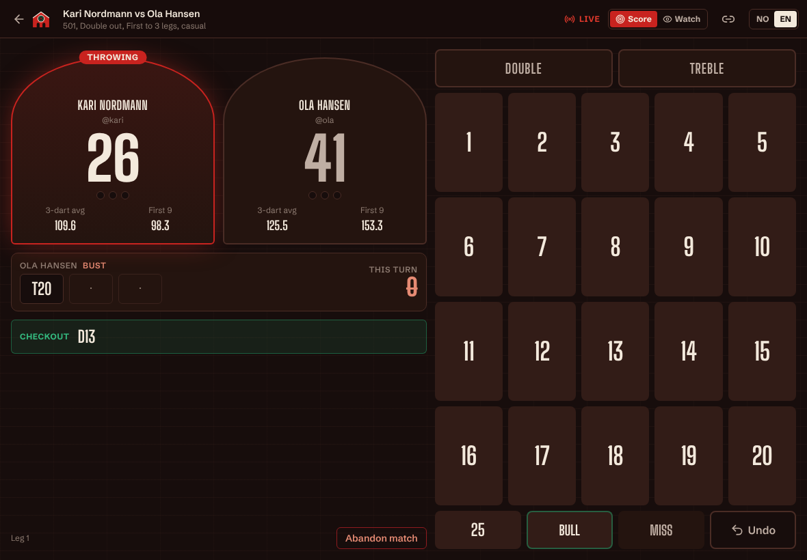
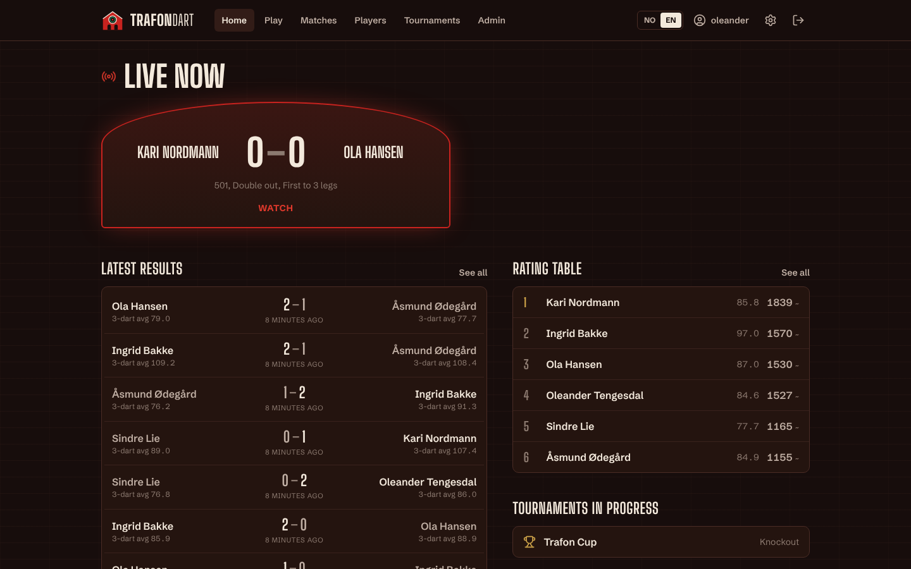
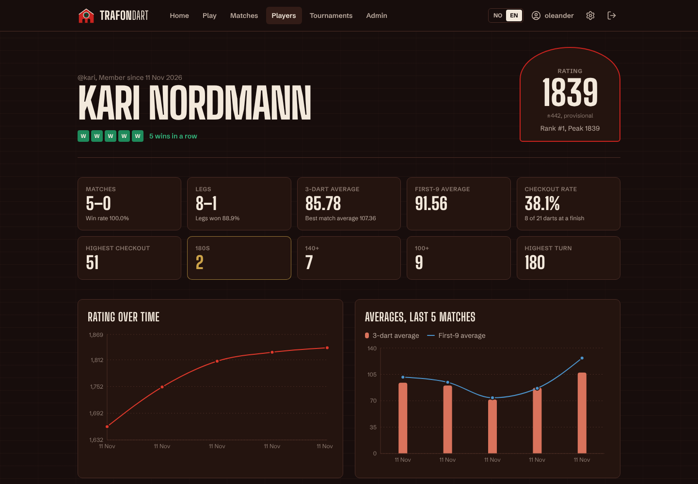
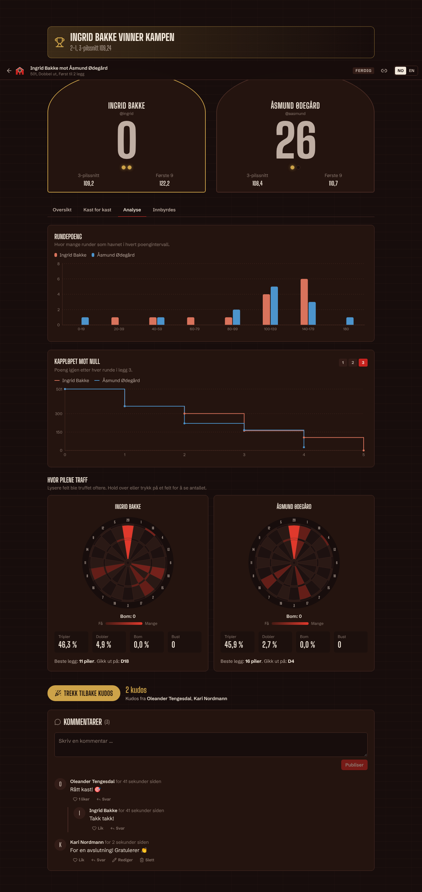

# TrafonDart

**Live darts scoring, Glicko-2 ratings and automatic tournaments for our crew.** Score real matches from a tablet next to the board. Everyone else follows along live on their phone. Every dart feeds the stats dashboards.

Available in **Norwegian (bokmål)** and **English**. Switch with the NO/EN toggle in the header, and your choice follows your account to other devices.



| Live home page | Player dashboard |
|---|---|
|  |  |

<details><summary>Match analysis, kudos and comments</summary>



</details>

---

## What it does

- **Touch scorepad.** Big keys for 1–20, Double, Treble, 25, Bull, Miss and Undo. Works on a tablet in landscape and on a phone in portrait.
- **X01 rules engine.** 301, 501 and 701, with Straight or Double in and Straight, Double or Master out. Busts are detected automatically: a score below zero, a dead 1, or finishing on the wrong dart.
- **Checkout assistant.** The best route for the darts left this turn, for example `120 → T20 20 D20`.
- **Live spectating.** Every dart is pushed over WebSockets (STOMP). Anyone in the group can open the match link and watch.
- **Callouts.** A flash, a chime and a spoken *"One hundred and eighty!"* (or *"Hundreåtti!"*) for 180s, 100+ finishes, busts and game shots. There's also an optional "voice caller" that reads out every turn score.
- **Glicko-2 ratings.** Rating, rating deviation and volatility, with a history chart. Ratings stay *provisional* until they settle.
- **Statistics.** Win/loss, legs, 3-dart and first-9 averages, 180s, 140+ and 100+ turns, highest checkout, checkout percentage, current form and head-to-head records.
- **Kudos and comments.** Give kudos to a match, comment, reply in threads and like comments. Updates arrive live for everyone on the page.
- **Deep match analysis.** Tabs for turn by turn, score-range charts, a "race to zero" chart per leg, a dartboard heatmap for each player, pre-match win probability and the head-to-head record.
- **Darts nerd corner on profiles.** Darts thrown, treble/double/bull/miss rates, best leg, darts per leg won, hold and break rates, most common turn, favourite number and finishing doubles, best checkouts, kudos received, plus a dartboard heatmap of every dart.
- **Tournaments.** Round-robin leagues and knockout cups. Seeds come from rating and byes are handled automatically. The bracket fills itself in as matches finish.
- **Invite-only sign-up.** Admins create codes with a maximum number of uses and an expiry date, and can revoke them.
- **Password reset without email.** An admin creates a one-time link (valid 24 hours) under *Admin → Members → Password link* and sends it, for example on Messenger. The person picks a new password and is logged in. The admin never sees the password, all other sessions end, and any login lock-out is lifted.
- **Bug reports.** A "Found a bug?" page opens an email to the admins with a ready-made template. The address is set with `VITE_CONTACT_EMAIL`, default `adminsjef@uka.no`.
- **Disputes.** A player can report a scoring mistake. If an admin voids the match, all ratings are recalculated.

## Tech stack

| | |
|---|---|
| Backend | Java 21, Spring Boot 4.1, Spring Security 7, Spring Data JPA (Hibernate 7), Flyway, STOMP over WebSocket, Nimbus JOSE (JWT) |
| Frontend | React 19, TypeScript, Vite 7, Tailwind CSS 4, TanStack Query, react-i18next, Recharts, Lucide, @stomp/stompjs |
| Database | PostgreSQL 16 |
| Hosting | Vercel (frontend) + Render (backend, Docker) + Neon (Postgres), all on free tiers |

## Repository layout

```
TrafonDart/
├── backend/            Spring Boot API + live socket (Dockerfile for Render)
├── frontend/           React app (vercel.json for Vercel)
├── docs/               Architecture, rules, ratings, security, deployment …
├── scripts/            Demo-data seeder, local DB init
├── docker-compose.yml  Local PostgreSQL
├── render.yaml         Render blueprint for the backend
└── .env.example        Template for your local, git-ignored .env
```

## Quick start (local)

Prerequisites: **Java 21**, **Maven 3.9+**, **Node 22**, and **Docker** (for PostgreSQL).

```bash
# 1. Configuration – .env is git-ignored, never commit it
cp .env.example .env            # then edit the passwords in .env

# 2. Database
docker compose up -d

# 3. Backend on http://localhost:8080
cd backend && ./run-dev.sh

# 4. Frontend on http://localhost:5173 (new terminal)
cd frontend && npm install && npm run dev
```

Log in with the `BOOTSTRAP_ADMIN_*` credentials from your `.env`. Then go to **Admin → Invite codes** to invite your friends.

Want something to look at straight away? Seed demo players, matches and a half-played cup:

```bash
python3 scripts/seed_demo.py --admin admin --password '<your BOOTSTRAP_ADMIN_PASSWORD>'
```

The full guide, including how to run the tests, is in [docs/LOCAL-DEVELOPMENT.md](docs/LOCAL-DEVELOPMENT.md).

## Deploying

The step-by-step guide is in [docs/DEPLOYMENT.md](docs/DEPLOYMENT.md). In short:

1. **Neon:** create a free Postgres project and copy the connection details.
2. **Render:** *New → Blueprint* from this repo. Fill in the database URL, the user, the password and your Vercel URL. `JWT_SECRET` is generated for you.
3. **Vercel:** import the repo with root directory `frontend`. Point the `/api` rewrite and the CSP in `frontend/vercel.json` at your Render URL, and set `VITE_WS_URL`.

## Testing

```bash
cd backend  && mvn verify          # 62 tests: engine, checkouts, Glicko-2, brackets + end-to-end API against Postgres
cd frontend && npm run i18n:check && npm test && npm run lint && npm run build
```

CI (GitHub Actions) runs all of this on every push and pull request, plus a **gitleaks** secret scan.

## Keeping secrets out of Git

This repository is meant to be public-safe:

- All secrets come from environment variables. Only `*.example` templates are committed.
- `.gitignore` blocks `.env`, `.env.*`, key stores and local Spring config.
- Production refuses to start without a strong `JWT_SECRET`.
- The bootstrap admin is created from env vars, so no password ever lives in code.
- CI fails the build if gitleaks finds anything that looks like a secret.

Read [docs/SECURITY.md](docs/SECURITY.md) before you deploy.

## Documentation

| Document | Contents |
|---|---|
| [PLAN.md](docs/PLAN.md) | The original plan and the key decisions |
| [ARCHITECTURE.md](docs/ARCHITECTURE.md) | Components, request flow, live updates, package layout |
| [DATABASE.md](docs/DATABASE.md) | ER diagram and table reference |
| [API.md](docs/API.md) | REST endpoints, socket topics, error codes |
| [GAME-RULES.md](docs/GAME-RULES.md) | X01 rules, busts, checkout routing, how statistics are defined |
| [RATINGS.md](docs/RATINGS.md) | How Glicko-2 is applied |
| [SECURITY.md](docs/SECURITY.md) | Threat model and mitigations |
| [DEPLOYMENT.md](docs/DEPLOYMENT.md) | Neon + Render + Vercel, step by step |
| [LOCAL-DEVELOPMENT.md](docs/LOCAL-DEVELOPMENT.md) | Running, testing and seeding locally |
| [I18N.md](docs/I18N.md) | Adding or changing Norwegian/English text |
| [DESIGN.md](docs/DESIGN.md) | The "Trafon after dark" visual language |

---

### Norsk kortversjon

TrafonDart er en privat app for gjengen. Den fører dartkamper live fra et nettbrett ved skiva, regner ut Glicko-2-rating og statistikk, og kjører serier og cuper automatisk. Hele grensesnittet finnes på norsk og engelsk. Se *Quick start* over for å kjøre den lokalt, og [docs/DEPLOYMENT.md](docs/DEPLOYMENT.md) for å publisere den gratis på Vercel, Render og Neon. Ingen hemmeligheter skal i Git. Bruk `.env`, som er ignorert, og miljøvariabler i Render og Vercel.
