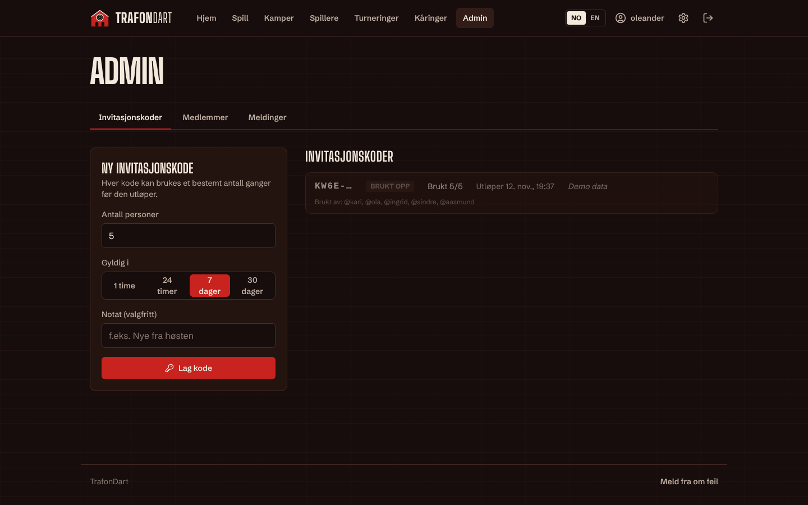
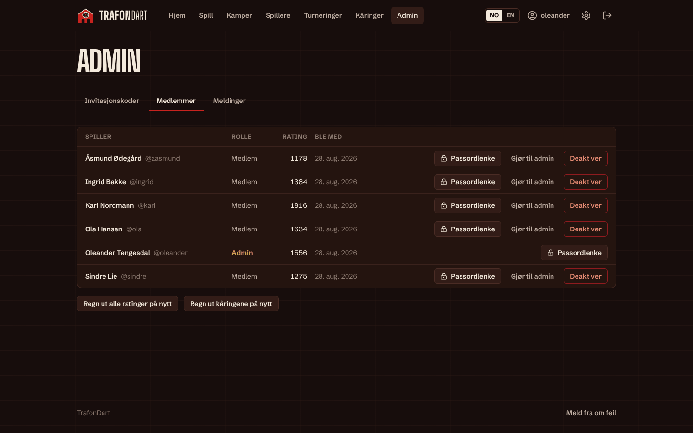
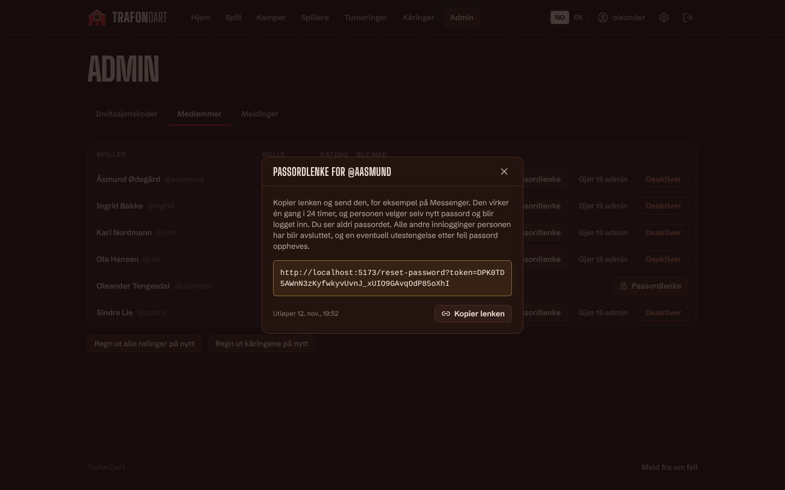

# Adminveiledning

For dere som har admin-rollen. Admin-siden ligger under **Admin** i menyen (skjoldet i mobilmenyen) og har tre faner: **Invitasjonskoder**, **Medlemmer** og **Meldinger**.

> Den aller første adminen lages fra miljøvariablene `BOOTSTRAP_ADMIN_*` første gang serveren starter med en tom database. Se [DEPLOYMENT.md](DEPLOYMENT.md#2-backend-on-render).

## Invitere nye spillere

**Admin → Invitasjonskoder → Ny invitasjonskode**

1. **Antall personer:** hvor mange som kan registrere seg med koden (1–100).
2. **Gyldig i:** 1 time, 24 timer, 7 dager eller 30 dager.
3. **Notat** (valgfritt), for eksempel «Nye fra høsten». Bare adminer ser det.
4. Trykk **Lag kode**, og kopier koden eller registreringslenken.

Koden vises **bare én gang**. Databasen lagrer bare en hash av den, så ingen kan hente den frem igjen senere. Mistet du den, lager du bare en ny.

Listen viser de fire første tegnene, hvor mange som har brukt koden, hvem de er og når den utløper. **Trekk tilbake** stopper en kode med en gang.

## Medlemmer

| Knapp | Hva den gjør |
|---|---|
| **Passordlenke** | lager en engangslenke for nytt passord (se under) |
| **Gjør til admin / Gjør til medlem** | endrer rollen. Personen blir logget ut og må logge inn igjen. Du kan ikke endre deg selv, og den siste adminen beholdes alltid |
| **Deaktiver / Aktiver** | en deaktivert konto kan ikke logge inn og blir logget ut overalt. Kampene og statistikken blir liggende, men personen vises ikke i spillerlister og kan ikke vinne månedens kåringer |
| **Regn ut alle ratinger på nytt** | spiller alle ratede kamper på nytt i rekkefølge. Trengs nesten aldri: det skjer automatisk når en kamp annulleres. Regner også ut månedens kåringer på nytt |
| **Regn ut kåringene på nytt** | glemmer alle avgjorte måneder og år og kårer dem på nytt fra kampene. Nyttig hvis dere har endret reglene i [AWARDS.md](AWARDS.md) |

### Slettede kontoer

Medlemmer kan slette sin egen konto under *Innstillinger → Dine data* (se [PRIVACY.md](PRIVACY.md)). En slettet konto står i lista som **«Slettet spiller»** med merket **Slettet**, uten knapper: den kan ikke aktiveres igjen, gjøres til admin eller få en passordlenke. Kampene blir liggende. Vil personen tilbake, lager du en ny invitasjonskode; den nye kontoen starter blankt. Er du den eneste adminen, må du gjøre noen andre til admin før du kan slette din egen konto.

### Glemt passord

Gå til **Admin → Medlemmer** og trykk **Passordlenke** ved personen. Kopier lenken og send den, for eksempel på Messenger. Den virker én gang i 24 timer, og personen velger selv nytt passord og blir logget inn. Du ser aldri passordet. Alle andre innlogginger personen har blir avsluttet, og en eventuell utestengelse etter feil passord oppheves.

Lager du en ny lenke til samme person, slutter den gamle å virke.

## Meldinger om feilføring

Spillerne i en ferdig kamp kan melde fra hvis noe ble ført feil. Meldingene dukker opp under **Admin → Meldinger**.

- **Behold resultatet:** kampen står som den er.
- **Annuller kampen:** kampen teller ikke lenger. Alle ratinger regnes ut på nytt fra starten, statistikken oppdateres, og månedens kåringer fra den måneden og fremover avgjøres på nytt.

Det finnes ingen måte å «rette» enkeltpiler i en ferdig kamp. Det er med vilje: pilene er fasiten alt annet regnes ut fra. Annuller og spill kampen på nytt.

## Månedens spiller og årets spiller

Ingenting å gjøre. Måneden avgjøres av seg selv den 1., og året 1. januar (eller første gang noen åpner appen etter det, hvis serveren sov). Tre innstillinger kan justeres som miljøvariabler i Render:

| Variabel | Standard | |
|---|---|---|
| `AWARDS_MIN_MATCHES` | `3` | kamper som trengs i måneden for å bli månedens spiller |
| `AWARDS_MIN_MATCHES_YEAR` | `10` | ratede kamper som trengs i året for å bli årets spiller |
| `AWARDS_ZONE` | `Europe/Oslo` | tidssonen måneden og året følger |

## Feilvarsler

Med `SENTRY_DSN` satt i Render får dere e-post fra Sentry når appen krasjer, både på serveren og i nettleseren, uten navn eller andre personopplysninger. Oppsettet tar fem minutter: se [OPERATIONS.md](OPERATIONS.md).

## Selskapsspill, utfordringer og TV-modus

Ingenting å administrere. Selskapsspill teller aldri på rating eller kåringer, så det finnes ingen meldinger om feilføring for dem; et spill som ble feil kan avbrytes av spillerne, den som startet det eller en admin. Utfordringer utløper av seg selv etter 48 timer. TV-modus (`/tv`) krever innlogging: logg inn på TV-maskinen med en vanlig konto.

## Turneringer

Alle kan lage turneringer. Den som lager en turnering (og alle adminer) kan endre deltakere før start, starte den og avlyse den. I en turnering som teller på ratingen starter spillerne kampene sine selv (eller en admin), så ingen kan føre en ratet kamp for to andre alene.

## Sikkerhetsrutiner

- Bruk et langt, unikt passord. Bytt passord i *Innstillinger* etter første innlogging, og slett `BOOTSTRAP_ADMIN_PASSWORD` i Render.
- Gi admin-rollen til så få som mulig.
- Trekk tilbake invitasjonskoder som ikke trengs lenger.
- Har noen mistet en telefon, deaktiver kontoen eller lag en passordlenke. Begge logger personen ut overalt.
- Ta backup jevnlig, se [DEPLOYMENT-PLAN.md](DEPLOYMENT-PLAN.md#8-backups).

Mer om hvordan appen er sikret står i [SECURITY.md](SECURITY.md).
