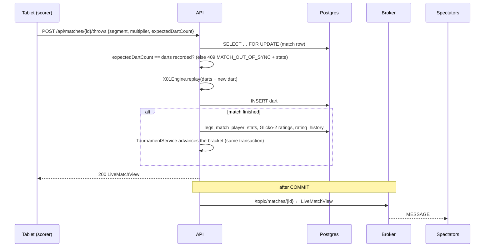

# Architecture

## Overview


## Request flow: scoring a dart



**Key ideas**

1. **Darts are the single source of truth.** The `darts` table stores only `(match, seq, segment, multiplier)`. Every number on screen (remaining, busts, legs won, averages, checkout hint) is recomputed by the pure `X01Engine.replay(...)`. Undo is "delete the last dart and replay", which stays correct even when the dart being undone was a leg-winning checkout.
2. **Optimistic concurrency per dart.** The client sends the dart count it expects. Double taps and two tablets scoring the same match cannot record a dart twice. The loser gets `MATCH_OUT_OF_SYNC` together with the current state and just re-renders.
3. **The socket is read-only.** All writes go through REST, which carries CSRF protection, validation and auth. The socket only broadcasts, and only after the database transaction commits, so spectators never see a state that was rolled back.
4. **The completion pipeline is one transaction.** Legs, per-player stats, both ratings and tournament progression are all written atomically with the final dart.
5. **Domain events decouple modules.** `MatchService` publishes `MatchCompleted`, `MatchAbandoned` and `MatchVoided` (`GameService` publishes `GameUpdated` and `GameCompleted`). `TournamentService` listens synchronously in the same transaction, and `AwardService` listens to `MatchVoided` so it can re-decide the affected months. Broadcast events (`MatchUpdated`, `FeedChanged`, `TournamentUpdated`) are handled `AFTER_COMMIT` by `Broadcaster`.

## Backend packages

```
no.trafondart
├── TrafonDartApplication
├── config/       AppProperties (all env-driven settings), SecurityConfig
├── common/       ErrorCode, ApiException, ApiError, GlobalExceptionHandler, RateLimiter, ClientIpResolver, TextInput,
│                 ErrorReporter (Sentry envelopes, scrubbed) + ClientErrorController
├── auth/         JWT (Nimbus HS256), session cookie, cookie auth filter, login/register/password,
│                 invite codes (hashed, max uses, expiry), admin password reset links, bootstrap admin
├── user/         User entity, user & admin controllers, DTOs
├── game/         Dart, GameConfig, OutRules, X01Engine, CheckoutCalculator   ← no Spring, pure
├── match/        Match/darts/legs/stats/disputes entities, MatchService, MatchViewMapper, events
├── rating/       Glicko2 (pure maths), RatingService (apply + full recompute), RatingHistory
├── stats/        StatsService: profile, head-to-head, leaderboard
├── analysis/     DartAnalytics (pure) + AnalyticsService: match breakdown, heatmaps, dart-nerd stats
├── social/       kudos, comment threads, likes (+ live ping on /topic/matches/{id}/social)
├── awards/       MonthlyScore (pure formula), AwardService (race, finalising months, badges),
│                 YearAwardService (Player of the Year), AwardController
├── party/        party games: PartyRules + PartyEngine (pure: X01 group/doubles, Cricket, Killer, Around the Clock),
│                 Game entities, GameService, GameController
├── bot/          Trafo, the practice bot: Dartboard + BotPlayer + BotLevel (pure: board geometry, aiming, scatter),
│                 BotMatch entities in their own tables, BotMatchService (plays Trafo's turns, the record), BotController
├── history/      PlayerHistoryService (one player's matches + games), AchievementService, RecapService
├── challenge/    challenge a friend: Challenge, ChallengeService, ChallengeController
├── account/      AccountService: data export and account deletion
├── tournament/   BracketGenerator (pure), Tournament/Participant/Fixture, TournamentService
└── realtime/     WebSocketConfig, StompAuthInterceptor, single-use ws tickets (UsedTickets), Broadcaster, JSON converter
```

## Frontend structure

```
frontend/src
├── main.tsx              QueryClient, router, error handlers, service worker registration (production)
├── App.tsx               routes (heavy pages lazy-loaded)
├── index.css             Tailwind 4 theme: colour scales and roles, fonts, type and radii ("Trafon at dusk"), arch + numerals utilities
├── api/                  fetch client (CSRF), DTO types, React Query hooks
├── realtime/             one shared STOMP connection with ticket auth, useTopic hook
├── auth/                 current user, route guards, account language, sessionExpiry (the login page's "session ran out" note)
├── i18n/                 i18next setup, locales/nb.json + en.json
├── lib/                  Intl formatting, sound (Web Audio + speech synthesis), wakeLock, errorReport + reporting,
│                         errors (every error sorted into a kind), pageTitle (tab titles), palette (chart colours), useOnline
├── components/           Layout, Logo, Facade illustration, UI kit, MatchRow, PlayerName
├── features/match/       ArchScore, Keypad, TurnStrip, Celebration, MatchStatsTable, useScorer (dart queue)
├── features/match/…      AnalysisTabs, MatchAnalysis (turn by turn, analysis, head-to-head; lazy-loaded with the charts)
├── features/social/      MatchSocial (kudos, comments, replies, likes)
├── features/stats/       Recharts charts, DartboardHeatmap (SVG), DartNerd profile section
├── features/awards/      Medal (arched award badge), ReigningChip, CrownMark, useReigning
├── features/scoring/     dartQueue (pure) + useDartQueue: the offline-capable dart queue, OfflineNotice
├── features/games/       gameLogic (pure), Boards (X01, Cricket, Killer, Around the Clock scoreboards)
├── features/bot/         botLogic (pure: levels, which of Trafo's darts to show), BotRecordSection (profile)
├── features/achievements/ the cabinet; features/recap/ recap facts; features/challenges/ button + home card
└── pages/                one file per screen
```

### Errors

`lib/errors.ts` sorts every error into a kind (offline, waking, session, forbidden, not found, rate limited, server, conflict, invalid, unknown) and says whether a retry can help and what the way out is; `ErrorNotice` shows it. The `QueryCache`/`MutationCache` in `main.tsx` watch for a request refused as "not logged in" and forget the user, so `RequireAuth` sends them to the login page. Detail pages show their own "not found" (`pages/NotFoundPage.tsx`) for a 404 or a malformed id. How it looks is in [DESIGN.md](DESIGN.md#errors-and-not-found).

### The scorer's dart queue (and offline scoring)

`useDartQueue` (used by `useScorer` for matches and by the game page) lets the scorer keep tapping while a request is in flight (useful on a slow free-tier server). Darts queue up, show as dashed "pending" slots and are sent strictly in order, each with its `expectedDartCount`. Undo removes an unsent dart locally, or calls `POST /undo` once the queue is empty. While the queue is busy, socket pushes are ignored so the screen doesn't flicker between states.

When the network or the server is down, the queue is **kept**: it is saved in `localStorage` (`td.pending.match.<id>` / `td.pending.game.<id>`, with the dart count the first dart expects), a notice says how many darts are waiting, up to 30 darts can be typed, and sending is retried with backoff (1 s, 2 s, 4 s … 15 s) and at once on the browser's `online` event. After a reload the saved darts the server doesn't have yet are resent. Resending is safe because of `expectedDartCount`: if a retry is refused as out of sync and the server is exactly one dart ahead with *our* dart last (the answer to the first attempt was lost), the dart counts as sent; any other conflict means someone else scored, and the server's state wins. The pure rules are in `features/scoring/dartQueue.ts`, with unit tests; how it was checked in a real browser is in [TESTING.md](TESTING.md).

## Installable app (PWA)

- `public/manifest.webmanifest` + icons (`public/icons`, rendered from `favicon.svg`): installable from the browser menu, home-screen icon, full screen (`display: standalone`), shortcuts to *New match* and *TV*.
- `public/sw.js`, registered in production only. It caches the **app shell** (network first with a 2.5 s timeout, then the cached `index.html`) and the **hashed `/assets/*` files** (cache first, capped at 80). It never touches `/api`, `/ws`, other origins or anything but `GET` (tested in `scripts/sw.test.mjs`). So the app opens on a bad connection, and its "waking up the server" screen shows while a sleeping Render instance starts.
- `vercel.json` serves `/sw.js` with `Cache-Control: no-cache` so a new version reaches every tablet; a stale page that asks for a removed chunk reloads once.
- The match, game and TV screens keep the screen on with the **Screen Wake Lock API** (`lib/wakeLock.ts`), taken again whenever the page becomes visible. Where it isn't supported nothing happens.

## Party games, achievements, recap

- `party/PartyEngine` is pure, like `X01Engine`: `replay(type, settings, sides, darts)` → `PartyState`. `GameService` stores darts in `game_darts`, replays on every request, writes `game_results` when a game completes and broadcasts `GameView` on `/topic/games/{id}`. Games never reach the rating or award code.
- `history/PlayerHistoryService` loads one player's finished matches (with replays, stats, legs and ratings before) and games for a period. `AchievementService` walks them in order to find when each achievement was first unlocked; `RecapService` aggregates one year. Nothing is cached or stored ([ACHIEVEMENTS.md](ACHIEVEMENTS.md), [AWARDS.md](AWARDS.md)).
- `bot/`: a practice match is X01 against Trafo, replayed from `bot_match_darts` with the same `X01Engine`. After each of your darts, `BotMatchService` lets Trafo throw for as long as it is its turn: `BotPlayer.aim` picks the target (a double to get in, the checkout route, a set-up shot, or T20) and `throwAt` adds a Gaussian scatter of the level's spread on a millimetre `Dartboard`. The random generator is seeded with the match seed and the dart number, so undo can't re-roll Trafo. The tables are separate from `matches`, so rating, stats, awards, achievements and the recap can't see them; the player's numbers are copied into `bot_matches` when a match ends, and `record()` sums them for the profile. The frontend (`pages/BotPage`, `pages/BotMatchPage`, `features/bot/`) reuses the match scoreboard and shows Trafo's darts one by one from `botTurns`.
- `challenge/ChallengeService`: pending → accepted → started (creates the match through `MatchService.createInternal`), or declined / cancelled / expired (48 h, expired lazily on read). Limits: one open challenge per pair, five open sent per player, serialised per challenger with a row lock.

## Error alerts

`ErrorReporter` posts Sentry envelopes with the JDK HTTP client (no SDK) in the background, at most 30 a minute, after scrubbing personal data and secrets. The 500 handler reports server errors; the frontend's `RouteError` page and global `error`/`unhandledrejection` handlers report browser errors to `POST /api/client-errors`, which forwards them. See [OPERATIONS.md](OPERATIONS.md).

## Configuration

All configuration lives in `application.yml` and comes from environment variables:

| Variable | Default | Purpose |
|---|---|---|
| `DATABASE_URL` / `_USERNAME` / `_PASSWORD` | localhost | JDBC connection |
| `JWT_SECRET` | – (required outside dev) | HS256 key, at least 32 bytes |
| `JWT_TTL` | `14d` | session lifetime |
| `COOKIE_SECURE` | `true` | `Secure` flag on cookies |
| `WS_ALLOWED_ORIGINS` | `http://localhost:5173` | allowed socket origins |
| `TRUSTED_PROXY_HOPS` | `0` | proxies in front of the app (for client-IP rate limiting) |
| `BOOTSTRAP_ADMIN_USERNAME` / `_PASSWORD` / `_REAL_NAME` | – | first admin, only when there are no users |
| `AWARDS_ZONE` | `Europe/Oslo` | time zone that decides when a month starts and ends for Player of the Month |
| `AWARDS_MIN_MATCHES` | `3` | finished matches needed in a month to qualify for Player of the Month |
| `AWARDS_MIN_MATCHES_YEAR` | `10` | rated matches needed in a year to qualify for Player of the Year |
| `SENTRY_DSN` | – (off) | Sentry project DSN for error alerts ([OPERATIONS.md](OPERATIONS.md)) |
| `SENTRY_ENVIRONMENT` | `production` | environment name on each Sentry event |
| `DB_POOL_SIZE` | `5` | Hikari pool size |
| `PORT` | `8080` | HTTP port (Render sets this) |

## Monthly awards

`AwardService` turns a month of finished matches into a points table (see [AWARDS.md](AWARDS.md)). There is no counter that has to be kept in sync:

- **Current month:** computed on request from the completed matches in the month, their stats, legs, rating history and kudos. It is cheap: a friend group plays tens of matches a month, not millions.
- **Past months:** decided once and stored in `monthly_awards`. `ensureFinalized()` runs at startup, from a `@Scheduled` job at 00:05 on the 1st, and lazily before every awards query, so a server that was asleep over midnight (Render free tier) still crowns the winner on the first visit.
- **Player of the Year:** `YearAwardService` sums the month points of a year, decides it on 1 January (same lazy and scheduled triggers) and stores it in `yearly_awards`.
- **Corrections:** voiding a match deletes the decided months (and years) from that month onwards. They are decided again on the next request. `POST /api/admin/awards/recompute` (and the ratings recompute) rebuilds all of them.
