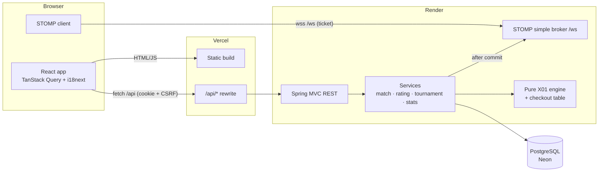
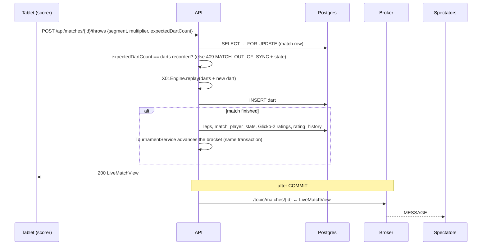

# Architecture

## Overview



## Request flow: scoring a dart



**Key ideas**

1. **Darts are the single source of truth.** The `darts` table stores only `(match, seq, segment, multiplier)`. Every number on screen (remaining, busts, legs won, averages, checkout hint) is recomputed by the pure `X01Engine.replay(...)`. Undo is "delete the last dart and replay", which stays correct even when the dart being undone was a leg-winning checkout.
2. **Optimistic concurrency per dart.** The client sends the dart count it expects. Double taps and two tablets scoring the same match cannot record a dart twice. The loser gets `MATCH_OUT_OF_SYNC` together with the current state and just re-renders.
3. **The socket is read-only.** All writes go through REST, which carries CSRF protection, validation and auth. The socket only broadcasts, and only after the database transaction commits, so spectators never see a state that was rolled back.
4. **The completion pipeline is one transaction.** Legs, per-player stats, both ratings and tournament progression are all written atomically with the final dart.
5. **Domain events decouple modules.** `MatchService` publishes `MatchCompleted`, `MatchAbandoned` and `MatchVoided`, and `TournamentService` listens synchronously in the same transaction. Broadcast events (`MatchUpdated`, `FeedChanged`, `TournamentUpdated`) are handled `AFTER_COMMIT` by `Broadcaster`.

## Backend packages

```
no.trafondart
├── TrafonDartApplication
├── config/       AppProperties (all env-driven settings), SecurityConfig
├── common/       ErrorCode, ApiException, ApiError, GlobalExceptionHandler, RateLimiter, ClientIpResolver
├── auth/         JWT (Nimbus HS256), session cookie, cookie auth filter, login/register/password,
│                 invite codes (hashed, max uses, expiry), admin password reset links, bootstrap admin
├── user/         User entity, user & admin controllers, DTOs
├── game/         Dart, GameConfig, OutRules, X01Engine, CheckoutCalculator   ← no Spring, pure
├── match/        Match/darts/legs/stats/disputes entities, MatchService, MatchViewMapper, events
├── rating/       Glicko2 (pure maths), RatingService (apply + full recompute), RatingHistory
├── stats/        StatsService: profile, head-to-head, leaderboard
├── analysis/     DartAnalytics (pure) + AnalyticsService: match breakdown, heatmaps, dart-nerd stats
├── social/       kudos, comment threads, likes (+ live ping on /topic/matches/{id}/social)
├── tournament/   BracketGenerator (pure), Tournament/Participant/Fixture, TournamentService
└── realtime/     WebSocketConfig, StompAuthInterceptor, ws tickets, Broadcaster, JSON converter
```

## Frontend structure

```
frontend/src
├── main.tsx              QueryClient, router
├── App.tsx               routes (heavy pages lazy-loaded)
├── index.css             Tailwind 4 theme tokens ("Trafon after dark"), arch + numerals utilities
├── api/                  fetch client (CSRF), DTO types, React Query hooks
├── realtime/             one shared STOMP connection with ticket auth, useTopic hook
├── auth/                 current user, route guards, account language
├── i18n/                 i18next setup, locales/nb.json + en.json
├── lib/                  Intl formatting, sound (Web Audio + speech synthesis)
├── components/           Layout, Logo, Facade illustration, UI kit, MatchRow, PlayerName
├── features/match/       ArchScore, Keypad, TurnStrip, Celebration, MatchStatsTable, useScorer (dart queue)
├── features/match/…      MatchAnalysis (turn by turn, analysis, head-to-head tabs)
├── features/social/      MatchSocial (kudos, comments, replies, likes)
├── features/stats/       Recharts charts, DartboardHeatmap (SVG), DartNerd profile section
└── pages/                one file per screen
```

### The scorer's dart queue

`useScorer` lets the scorer keep tapping while a request is in flight (useful on a slow free-tier server). Darts queue up, show as dashed "pending" slots and are sent strictly in order, each with its `expectedDartCount`. Undo removes an unsent dart locally, or calls `POST /undo` once the queue is empty. While the queue is busy, socket pushes are ignored so the screen doesn't flicker between states.

## Configuration

All configuration lives in `application.yml` and comes from environment variables:

| Variable | Default | Purpose |
|---|---|---|
| `DATABASE_URL` / `_USERNAME` / `_PASSWORD` | localhost | JDBC connection |
| `JWT_SECRET` | – (required outside dev) | HS256 key, at least 32 bytes |
| `JWT_TTL` | `14d` | session lifetime |
| `COOKIE_SECURE` | `true` | `Secure` flag on cookies |
| `WS_ALLOWED_ORIGINS` | `http://localhost:5173` | allowed socket origins |
| `TRUSTED_PROXY_HOPS` | `0` | proxies in front of the app (for client-IP rate limiting) |
| `BOOTSTRAP_ADMIN_*` | – | first admin, only when there are no users |
| `DB_POOL_SIZE` | `5` | Hikari pool size |
| `PORT` | `8080` | HTTP port (Render sets this) |
