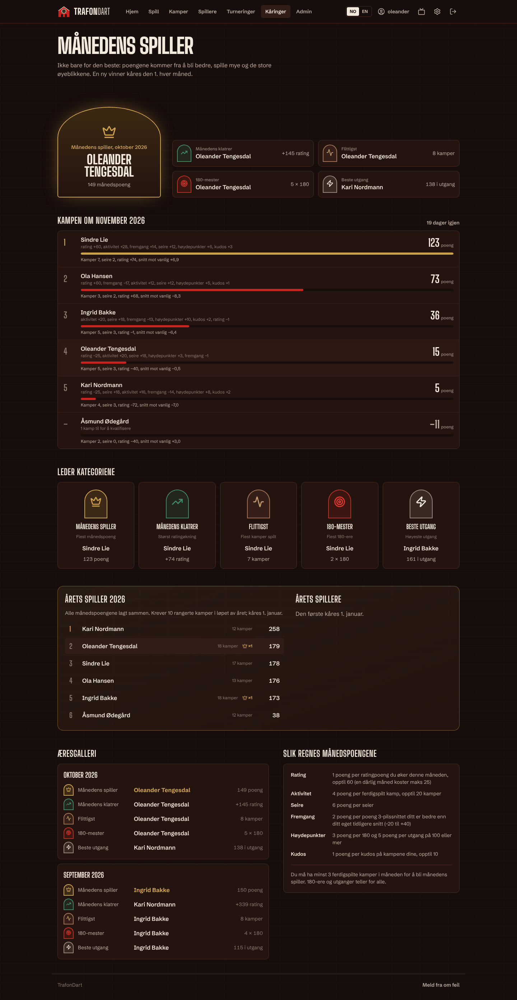

# Player of the Month, Player of the Year and the year recap

Ratings already tell you who the strongest player is. Player of the Month is meant to reward something else: **getting better, playing a lot and the big moments**. The strongest player can win it, but only by also turning up and improving. Someone who has been losing for months can win it by having their best month.

Every month has five awards. The winners get a badge in the trophy cabinet on their profile, and the Player of the Month wears a crown next to their name for the whole of the following month.

## The five awards

| Award (nb / en) | Goes to | Who can win it |
|---|---|---|
| **Månedens spiller** / Player of the Month | most month points (below) | players with at least `AWARDS_MIN_MATCHES` (default **3**) finished matches in the month |
| **Månedens klatrer** / Climber of the Month | biggest rating gain over the month | the same qualified players, and only if the gain is above zero |
| **Flittigst** / Most active | most finished matches | the same qualified players |
| **180-mester** / 180 master | most 180s | everyone who finished a match, if at least one 180 was thrown |
| **Beste utgang** / Best finish | highest checkout | everyone who finished a match |

A category is never handed out just to fill it: if nobody gained rating, there is no Climber of the Month that month. Ties go to whoever is higher in the month-points table.

## Month points

Points are added up from six parts. The constants live in `backend/src/main/java/no/trafondart/awards/MonthlyScore.java`.

| Part | Points | Limits | Why |
|---|---|---|---|
| **Rating** | 1 per rating point gained in the month | at most **+60**, at least **−25** | rewards beating people, but a new player's provisional jumps (hundreds of points) can't decide the month alone, and one bad month doesn't sink you |
| **Activity** | 4 per finished rated match | up to 20 matches (80 points) | turning up matters |
| **Wins** | 6 per match won | – | |
| **Improvement** | 2 per point your 3-dart average this month beats *your own* average before the month | **−20 to +40** | the "best development" award: compares you with yourself, not with the others. Zero for players with no earlier matches |
| **Highlights** | 3 per 180, 5 per checkout of 100 or more | – | the moments everyone remembers |
| **Kudos** | 1 per kudos on your matches this month | up to 10 | a little nod to the social side, capped so it can't be farmed |

The month is a calendar month in `AWARDS_ZONE` (default `Europe/Oslo`). A match counts in the month it was **finished**, in Oslo time (including summer time). Only **rated** matches count: a rated match always involves the person who set it up (or an admin), so nobody can invent matches for someone else to win awards with. Casual matches, voided and abandoned matches never count, and disabled accounts are left out. Your earlier average (for the improvement part) is taken from all your finished matches before the month.

### Worked example

Two players each finish 6 matches in a month.

| | Ola, getting better | Kari, already the best |
|---|---|---|
| Wins | 2 | 6 |
| Rating change | +30 | +10 (already rated high, so wins move her less) |
| Average this month / before | 55.0 / 50.0 | 80.0 / 80.0 |
| **Rating** | 30 | 10 |
| **Activity** | 24 | 24 |
| **Wins** | 12 | 36 |
| **Improvement** | (55 − 50) × 2 = 10 | 0 |
| **Total** | **76** | **70** |

Ola is Player of the Month. If Kari had played two more matches she would have overtaken him, which is exactly the point: both improving and playing a lot are rewarded. This example is a unit test (`MonthlyScoreTest`).

## When a month is decided

- The race for the current month is computed live and shown on the awards page and the home page.
- Finished months are decided **once** and stored (`award_periods`, `monthly_awards`). This happens:
  - at server start-up,
  - at 00:05 on the 1st (a scheduled job), and
  - lazily, before any awards request.

  The last one matters on the free Render plan, where the server is usually asleep at midnight. The first person to open the app on the 1st triggers it.
- **Voided matches:** when an admin voids a match, every decided month from that match's month onwards is deleted and decided again.
- **Admin override:** *Admin → Members → Recompute the monthly awards* re-decides every month from scratch. Recomputing ratings does this too, because the rating part depends on them.

## Where it shows up

| Place | What you see |
|---|---|
| **Kåringer** / Awards (top menu and phone tab bar) | last month's champion in a brass arch with the other four winners beside them, the live race with each player's points broken down, who leads each category right now, the hall of fame, and these rules |
| **Home page** | a card with the reigning Player of the Month and the top three in this month's race |
| **Leaderboards** | a small crown after the reigning player's name |
| **Profile** | a "Player of the Month, October 2026" chip under the name while reigning, and a trophy cabinet with every award the player has won |

## Tuning

| Variable | Default | |
|---|---|---|
| `AWARDS_ZONE` | `Europe/Oslo` | IANA time zone for month boundaries |
| `AWARDS_MIN_MATCHES` | `3` | matches needed to qualify. Lower it for a small group, raise it if one-off visitors keep winning |
| `AWARDS_MIN_MATCHES_YEAR` | `10` | rated matches in the year needed to be Player of the Year |

To change the formula itself, edit `MonthlyScore`, update `MonthlyScoreTest`, this document and the `awards.how.*` texts in both locale files, then run *Recompute the monthly awards* after deploying so old months use the new rules.

## Player of the Year (Årets spiller)

The whole year's race, built on the same points:

- **Year points = the sum of the player's month points** for every month of the year (rated matches only, exactly as
  in the monthly race; a bad month can count against you).
- To be eligible you need at least `AWARDS_MIN_MATCHES_YEAR` (default 10) rated matches in the year.
- The year is decided on **1 January** (a scheduled job, plus lazily on the first awards request, like months), stored in
  `award_years` and `yearly_awards`, and gives a **Player of the Year** badge (brass star) in the trophy cabinet,
  period `"2026"`.
- Voiding a match re-decides its month and its year. *Recompute the monthly awards* also re-decides every year.
- The race for the current year is on the awards page, with each player's matches and months won; the hall of fame
  lists past winners.

## The year recap ("Ditt 2026")

A Wrapped-style summary per player at `/players/<username>/recap`, from the profile (**Ditt 2026**) and promoted on the
home page in December (this year) and January (last year). It is available all year, marked "so far" for the current
one, and for every year since the player joined.

It uses **every** finished match the player was in (rated or not) plus their party games:

| Card | Meaning |
|---|---|
| Darts thrown | matches and party games; with the distance walked to the board (2.37 m, there and back, every three darts) |
| Matches won–lost | with win rate, three-dart average and longest winning run |
| Best month | the month with the most month points (rated matches) and its rank; times Player of the Month |
| Favourite finish | the dart that won the most legs; the most-hit number |
| Nemesis / favourite opponent | most losses against (ties: worst record), most wins against |
| Biggest win | the win over the highest-rated opponent (rating before the match, or current rating for casual matches) |
| Best match average | the match with the highest three-dart average |
| 180s, 140+, best checkout, best turn | counted over the year |
| Darts night | the weekday with the most matches and games |
| Party games | played and won, by type |
| Player of the Year race | rank and points if eligible, and a banner for the winner |
| Achievements | those unlocked during the year |

Endpoint: `GET /api/users/{username}/recap?year=`, see [API.md](API.md).
