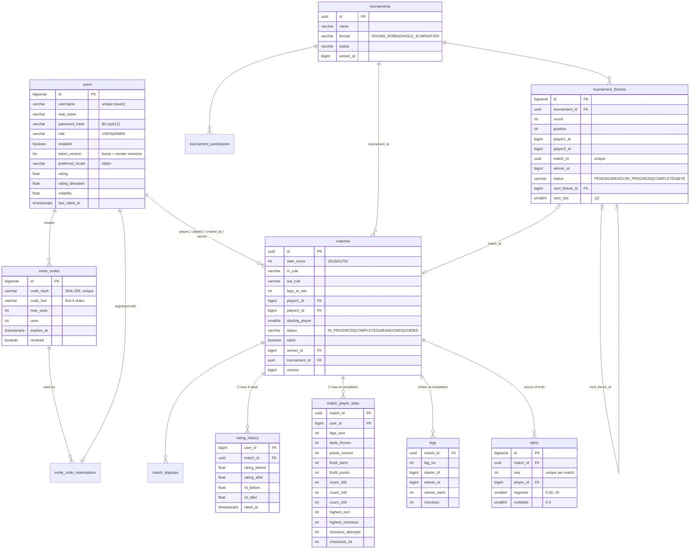

# Database

PostgreSQL 16. The schema is owned by Flyway (`backend/src/main/resources/db/migration`). Hibernate runs with `ddl-auto: validate`, so it only checks the schema and never changes it.

## ER diagram

## Social & password reset (V2)

| Table | Purpose |
|---|---|
| `match_kudos` | `(match_id, user_id)` primary key: one kudos per person per match |
| `match_comments` | `id, match_id, author_id, parent_id → match_comments (one level of replies), body ≤ 1000, deleted (soft delete when replies exist), created_at, edited_at` |
| `comment_likes` | `(comment_id, user_id)` primary key: one like per person per comment |
| `password_reset_tokens` | `user_id, token_hash (SHA-256, unique), expires_at, used_at, created_by`: admin-issued one-time links |

## Design notes

- **`darts` is the only live game state.** Legs, stats and ratings are *derived* and written once, when the match completes. Live views replay the darts, which takes microseconds for a few hundred darts.
- **Check constraints mirror the domain rules.** Examples: valid segment/multiplier pairs, `uses <= max_uses`, distinct players, allowed start scores. A bug in the service layer still can't write nonsense.
- **Indexes** cover the hot paths: case-insensitive username lookup, matches by player and completion time, the live-match list, rating history per user, fixtures per tournament. A partial unique index allows only one *open* dispute per match.
- **UUIDs** are used for matches and tournaments, which appear in shareable URLs. Everything else uses `bigserial`.
- **Concurrency:**
  - Scoring locks the match row (`SELECT … FOR UPDATE`).
  - Rating updates lock both player rows, in id order, to avoid deadlocks.
  - Invite redemption is a single conditional `UPDATE … WHERE uses < max_uses`, so concurrent sign-ups can never exceed the limit.
- **Statistics bands:** `count_140` is turns scoring 140–179 and `count_100` is 100–139. A 180 is counted only in `count_180`.

## Changing the schema

1. Add `V{n}__short_description.sql` in `db/migration`. Never edit a migration that has already run anywhere.
2. Update the entity, then run `mvn verify`. The integration test migrates a fresh database and Hibernate validates against it.
