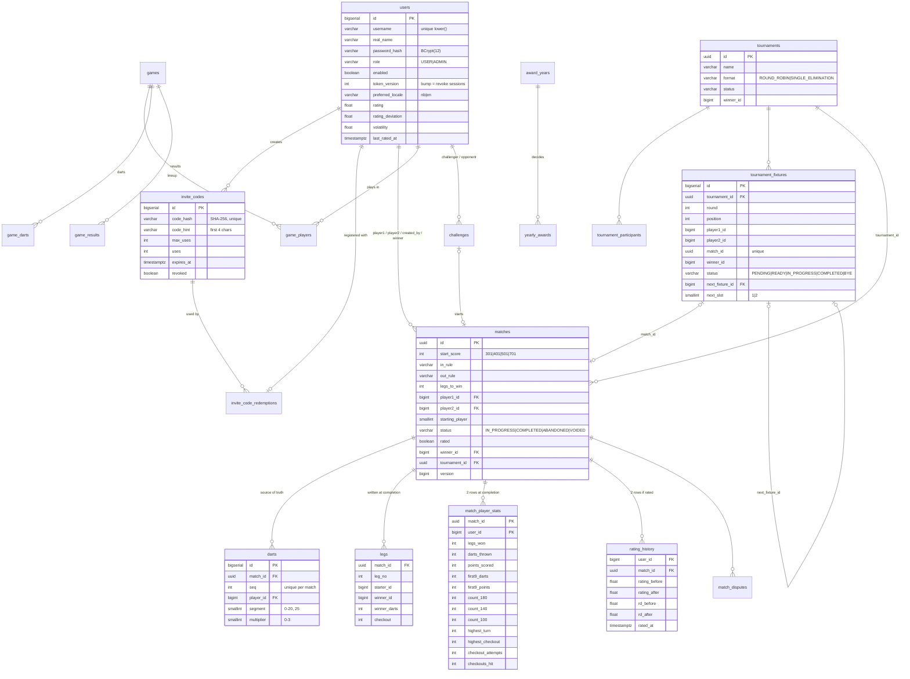

# Database

PostgreSQL 16. The schema is owned by Flyway (`backend/src/main/resources/db/migration`). Hibernate runs with `ddl-auto: validate`, so it only checks the schema and never changes it.

## ER diagram

## Social & password reset (V2)

| Table | Purpose |
|---|---|
| `match_kudos` | `(match_id, user_id)` primary key: one kudos per person per match |
| `match_comments` | `id, match_id, author_id, parent_id → match_comments (one level of replies), body ≤ 1000, deleted (soft delete when replies exist), created_at, edited_at` |
| `comment_likes` | `(comment_id, user_id)` primary key: one like per person per comment |
| `password_reset_tokens` | `user_id, token_hash (SHA-256, unique), expires_at, used_at, created_by`: admin-issued one-time links |

## Monthly awards (V3)

| Table | Purpose |
|---|---|
| `award_periods` | `period (YYYY-MM, primary key), finalized_at`: one row per month that has been decided. A month with no winners still gets a row, so it isn't recalculated over and over |
| `monthly_awards` | `id, period → award_periods (cascade), award (PLAYER_OF_MONTH, MOST_IMPROVED, MOST_ACTIVE, MOST_180S, HIGHEST_CHECKOUT), user_id → users (cascade), value, created_at`. Unique `(period, award)`: one winner per category per month. Index `(user_id, period desc)` for the trophy cabinet |

Awards are **derived data**, like ratings. The month points themselves are never stored: the race for the current month is computed on request from `matches`, `match_player_stats`, `legs`, `rating_history` and `match_kudos`. When a match is voided, every decided month from that match's month onwards is deleted and decided again. See [AWARDS.md](AWARDS.md).

## Party games, challenges, Player of the Year, account deletion (V4)

| Table / column | Purpose |
|---|---|
| `users.deleted_at` | set when a member deleted their account. Check: a deleted account is always disabled. The row stays so opponents' matches keep a player; the name becomes `deleted~<id>` / "Slettet spiller" (see [PRIVACY.md](PRIVACY.md)) |
| `games` | party games: `id (uuid), game_type (X01, CRICKET, KILLER, AROUND_THE_CLOCK), team_play, settings (JSON, ≤ 1000 chars), status (IN_PROGRESS, COMPLETED, ABANDONED), winner_side, created_by, created_at, completed_at, version`. Never rated |
| `game_players` | `(game_id, slot 0–7)` primary key, `user_id`, `side`. Unique `(game_id, user_id)`. In doubles the sides alternate 0, 1, 0, 1 |
| `game_darts` | `(game_id, seq)` primary key, `segment, multiplier, created_at`, with the same validity check as `darts`. Like matches, the darts are the only live state |
| `game_results` | one row per player when a game completes: `placement, darts_thrown, score, won`. Read by the profile statistics, achievements and the year recap |
| `challenges` | `id, challenger_id, opponent_id (distinct), start_score, in_rule, out_rule, legs_to_win, rated, message ≤ 200, status (PENDING, ACCEPTED, DECLINED, CANCELLED, EXPIRED, STARTED), match_id → matches (set null), created_at, expires_at, responded_at` |
| `award_years` | `year (primary key), finalized_at`: one row per decided year |
| `yearly_awards` | `(year → award_years cascade, award = PLAYER_OF_YEAR)` primary key, `user_id, value (year points), created_at` |

There is **no achievements table**: achievements are computed from matches, games and awards on request, so voiding a
match updates them automatically ([ACHIEVEMENTS.md](ACHIEVEMENTS.md)). The year recap is computed the same way.

## Practice against Trafo, and 401 (V5)

| Table / column | Purpose |
|---|---|
| `start_score` checks | `matches`, `tournaments` and `challenges` accept 301, 401, 501 and 701 |
| `bot_matches` | a practice match against the bot: `id (uuid), user_id, level (BEGINNER … PRO), start_score, in_rule, out_rule, legs_to_win, starting_player (0 = the player, 1 = Trafo), seed, status (IN_PROGRESS, COMPLETED, FORFEITED), won, created_at, completed_at, version`, plus the player's numbers stored when it ends (legs won and lost, darts, points, first 9, 180/140/100, highest turn and checkout, checkout attempts and hits, Trafo's average). Check: `won` is set exactly when the match is over. Partial unique index: one unfinished match per player |
| `bot_match_darts` | `(match_id → bot_matches cascade, seq)` primary key, `segment, multiplier`: both sides' darts in order (who threw each follows from the order) |

Kept in their own tables on purpose: nothing that reads `matches` (rating, leaderboard, head-to-head, awards,
achievements, recap, the live feed) can see them. They go with the account when it is deleted, and are in the data
export.

## Design notes

- **`darts` is the only live game state.** Legs, stats and ratings are *derived* and written once, when the match completes. Live views replay the darts, which takes microseconds for a few hundred darts.
- **Check constraints mirror the domain rules.** Examples: valid segment/multiplier pairs, `uses <= max_uses`, distinct players, allowed start scores. A bug in the service layer still can't write nonsense.
- **Indexes** cover the hot paths: case-insensitive username lookup, matches by player and completion time, the live-match list, rating history per user, fixtures per tournament. A partial unique index allows only one *open* dispute per match.
- **UUIDs** are used for matches, games and tournaments, which appear in shareable URLs. Everything else uses `bigserial`.
- **Concurrency:**
  - Scoring locks the match row (`SELECT … FOR UPDATE`).
  - Rating updates lock both player rows, in id order, to avoid deadlocks.
  - Invite redemption is a single conditional `UPDATE … WHERE uses < max_uses`, so concurrent sign-ups can never exceed the limit.
- **Statistics bands:** `count_140` is turns scoring 140–179 and `count_100` is 100–139. A 180 is counted only in `count_180`.

## Changing the schema

1. Add `V{n}__short_description.sql` in `db/migration`. Never edit a migration that has already run anywhere.
2. Update the entity, then run `mvn verify`. The integration test migrates a fresh database and Hibernate validates against it.
