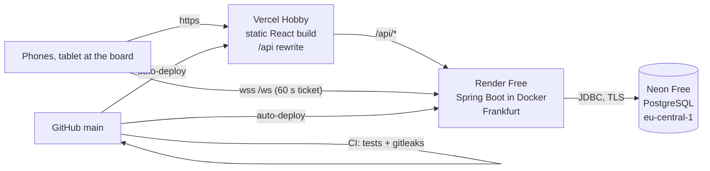

# Deployment plan

How TrafonDart goes from this repository to a URL the group uses every week, and how it is kept running afterwards. The click-by-click instructions for each provider are in [DEPLOYMENT.md](DEPLOYMENT.md). This document is the plan around them: order, checks, costs, risks, monitoring, backups and rollback.

**Owner:** the person holding the Render, Vercel and Neon accounts (normally the bootstrap admin).
**Effort:** about two hours for the first deployment, spread over one evening. A quiet evening plus one darts night for the soft launch.

## 1. Target



| Piece | Service | Plan | Region |
|---|---|---|---|
| Frontend + `/api` proxy | Vercel | Hobby (free) | global CDN |
| Backend + live socket | Render web service (Docker) | Free | Frankfurt |
| Database | Neon | Free | AWS eu-central-1 (Frankfurt) |
| Source, CI, secret scan | GitHub + Actions | Free | – |

Keeping Render and Neon in the same region keeps every database round-trip short. Every dart is one request with a few queries.

## 2. Environments

| Environment | Where | Data | Purpose |
|---|---|---|---|
| **Local** | your laptop, `docker compose` + `run-dev.sh` + `npm run dev` | demo data from `seed_demo.py` | development, screenshots |
| **CI** | GitHub Actions | throwaway Postgres service | every push and pull request: 305 backend tests, 94 frontend tests, lint, docs check, gitleaks |
| **Production** | Vercel + Render + Neon | the real group | the app |

There is deliberately no staging environment: the group is small, every change is covered by CI, and a bad deploy is rolled back in a minute (section 9). Vercel *preview* deployments are created for pull requests. They talk to the production API through the `/api` rewrite, so treat them as production. Live updates won't work on preview URLs, because their origin isn't in `WS_ALLOWED_ORIGINS`.

## 3. Phases and timeline

| # | Phase | Time | Done when |
|---|---|---|---|
| 0 | Preparation | 20 min | repo pushed, CI green, accounts created |
| 1 | Database (Neon) | 10 min | connection details noted in a password manager |
| 2 | Backend (Render) | 20 min + build | `/actuator/health` returns `UP` |
| 3 | Frontend (Vercel) | 15 min | the login page loads on the Vercel URL |
| 4 | Smoke test | 20 min | every item in the checklist below passes |
| 5 | Soft launch | one darts night | 2–3 friends registered, one real match played end to end |
| 6 | Go-live | 5 min | invite code shared with the whole group |
| 7 | After launch | ongoing | routines in section 10 |

### Phase 0: preparation

- [ ] `main` is pushed to GitHub and the CI workflow is green (tests, build, gitleaks).
- [ ] No secrets in the repository: `git ls-files | grep -Ei '\.env$|\.pem$|\.p12$|secret'` prints nothing except `.env.example`. CI's gitleaks job has passed on the full history.
- [ ] Accounts exist on GitHub, Neon, Render and Vercel. Turn on two-factor authentication on all four. Whoever controls these accounts controls the data.
- [ ] A password manager entry "TrafonDart production" is ready for the values below.

### Phase 1: database

Follow [DEPLOYMENT.md §1](DEPLOYMENT.md#1-database-on-neon).

- [ ] Project in **AWS Europe Central (Frankfurt)**.
- [ ] Compute size fixed at **0.25 CU** (min = max) with scale to zero enabled. This makes the free compute budget last (section 5).
- [ ] `DATABASE_URL` (with `jdbc:` and `?sslmode=require`), `DATABASE_USERNAME` and `DATABASE_PASSWORD` stored in the password manager.

### Phase 2: backend

Follow [DEPLOYMENT.md §2](DEPLOYMENT.md#2-backend-on-render).

- [ ] Blueprint created from `render.yaml`, region Frankfurt, plan Free.
- [ ] Secrets entered: database values, `BOOTSTRAP_ADMIN_PASSWORD` (at least 10 characters, generated by the password manager).
- [ ] `WS_ALLOWED_ORIGINS` set to the Vercel URL you expect (can be corrected after phase 3).
- [ ] The log shows `Successfully applied 3 migrations` and `Started TrafonDartApplication`.
- [ ] `https://<render-host>/actuator/health` → `{"status":"UP"}`.

### Phase 3: frontend

Follow [DEPLOYMENT.md §3](DEPLOYMENT.md#3-frontend-on-vercel).

- [ ] `frontend/vercel.json` points at the real Render host in **both** the rewrite and the CSP `connect-src`. Committed and pushed.
- [ ] Vercel project with root directory `frontend`. `VITE_WS_URL=wss://<render-host>/ws`. `VITE_CONTACT_EMAIL` only if it should differ from the default.
- [ ] If the final Vercel domain differs from what you put in `WS_ALLOWED_ORIGINS`, fix it in Render and redeploy.

### Phase 4: smoke test

Do this on a phone on mobile data (not Wi-Fi) and on the tablet that will live by the board.

- [ ] Log in as the bootstrap admin. Change the password in *Settings*, then delete `BOOTSTRAP_ADMIN_PASSWORD` in Render.
- [ ] Switch **NO / EN**, reload: the language sticks.
- [ ] *Admin → Invite codes*: create a code for 1 person, valid 1 hour. Register a second test account in a private window.
- [ ] Start a 301 match between the two accounts. Score a few darts on the tablet while the phone watches: every dart appears on the phone within a second. The "Reconnecting…" badge must not stay.
- [ ] Score a 180 (T20 ×3): flash, chime and voice.
- [ ] Bust once, then **Undo**.
- [ ] Finish the match. The ratings change, the match appears under *Recent results*, the profile shows statistics, and the awards page shows both players in this month's race.
- [ ] Give kudos and write a comment from the other account.
- [ ] *Admin → Members → Password link* for the test account, open it logged out, set a new password.
- [ ] Response headers on the Vercel URL include `Content-Security-Policy` and `Strict-Transport-Security` (browser dev tools → Network).
- [ ] Clean up: void or keep the test match (voiding recalculates ratings), and disable the test account.

### Phase 5: soft launch

Invite two or three people for one darts night with a code for 3 people, valid 24 hours. Watch for: the cold start when the first person opens the app (about a minute), the tablet staying connected for a whole evening, and anything confusing in the scorer. Fix, push, and let CI and auto-deploy do the rest.

### Phase 6: go-live

- [ ] Create an invite code for the rest of the group (e.g. 20 people, 7 days).
- [ ] Share the sign-up link and the [user guide](USER-GUIDE.md) in the group chat.
- [ ] Pin the app on the tablet's home screen (Share → Add to Home Screen) and turn off auto-lock while playing.

## 4. Configuration inventory

| Variable | Where | Secret | Value |
|---|---|---|---|
| `DATABASE_URL` | Render | no (but don't publish it) | Neon JDBC URL |
| `DATABASE_USERNAME` | Render | no | Neon role |
| `DATABASE_PASSWORD` | Render | **yes** | Neon password |
| `JWT_SECRET` | Render | **yes** | generated by Render, never copied anywhere |
| `BOOTSTRAP_ADMIN_USERNAME` / `_REAL_NAME` | Render | no | first admin |
| `BOOTSTRAP_ADMIN_PASSWORD` | Render | **yes** | delete after first login |
| `WS_ALLOWED_ORIGINS` | Render | no | `https://<vercel-domain>` |
| `COOKIE_SECURE`, `TRUSTED_PROXY_HOPS`, `DB_POOL_SIZE` | `render.yaml` | no | `true`, `2`, `5` |
| `AWARDS_ZONE`, `AWARDS_MIN_MATCHES`, `AWARDS_MIN_MATCHES_YEAR` | Render (optional) | no | `Europe/Oslo`, `3`, `10` |
| `SENTRY_DSN`, `SENTRY_ENVIRONMENT` | Render (optional) | not strictly, keep out of Git | Sentry project DSN, `production` |
| `VITE_WS_URL` | Vercel | no | `wss://<render-host>/ws` |
| `VITE_CONTACT_EMAIL` | Vercel (optional) | no | bug-report address |
| Render host | `frontend/vercel.json` | no | rewrite + CSP |

Rotating a secret:

- **`JWT_SECRET`:** edit it in Render (any random 32+ byte value) and redeploy. Everyone is logged out once.
- **Database password:** reset it in Neon, paste it into Render, redeploy.

## 5. Costs and capacity

| Service | Free allowance (checked November 2026) | What TrafonDart uses |
|---|---|---|
| Render Free | 750 instance hours per workspace per month. Sleeps after 15 minutes without HTTP or WebSocket traffic, about a minute to wake | awake only around darts nights: typically 40–150 hours a month |
| Neon Free | 1 GB storage and 100 CU-hours of compute per project per month. Scales to zero after 5 minutes idle | a match is roughly 20–50 kB including indexes (darts, legs, stats, rating history). 1 GB is tens of thousands of matches. At 0.25 CU, 100 CU-hours is about 400 awake hours |
| Vercel Hobby | personal, non-commercial use. 100 GB transfer per month | a few MB per visitor per month |
| GitHub Actions | free for public repositories, a monthly quota for private ones | about 5 minutes per push |

**Total: 0 kr/month.**

Neon stays awake for as long as Render is awake, because the connection pool keeps one connection open. That is why the two budgets line up. It is also why you should **not** add an uptime pinger that keeps Render awake around the clock: Render would stay within its 750 hours (about 720 in a month), but Neon would then need about 180 CU-hours at 0.25 CU and be suspended for the rest of the month.

**Upgrade path** if the cold start becomes annoying or the group grows:

| Change | Cost | Effect |
|---|---|---|
| Render Starter instance | from about $7/month | no sleeping, instant first load |
| Neon Launch | pay as you go (about $0.11 per CU-hour, $0.35 per GB-month) | no compute cap, longer restore window |
| Vercel Pro | $20 per seat per month | only needed for commercial use or team access |

Prices change. Check each provider's pricing page before upgrading.

## 6. Risks

| Risk | Likelihood | Impact | Mitigation |
|---|---|---|---|
| Cold start (about a minute) on the first visit of the evening | certain on Free | low | the app retries on its own. Open it a few minutes before playing. Upgrade Render if it bothers people |
| Free-tier terms change | medium | medium | everything is standard Docker + Postgres + static files. The alternatives in [DEPLOYMENT.md](DEPLOYMENT.md#alternatives) need no code changes |
| Neon compute budget runs out mid-month | low | high (app stops until next month) | fixed 0.25 CU, no keep-alive pinger, watch usage in Neon monthly |
| Accidental data loss (bad migration, wrong void, dropped table) | low | high | Neon's restore window, weekly `backup-db.sh` copies, restore drill (section 8) |
| Leaked secret | low | high | secrets only in provider dashboards, gitleaks in CI, 2FA on accounts, rotation steps in section 4 |
| Account takeover of a player | low | medium | BCrypt, login rate limits, admin can disable or reset. Every password change logs out other sessions |
| Scoring disputes | medium | low | players report, admins void, ratings and awards recompute automatically |
| The account owner leaves the group | medium | high | make a second admin, and add a second owner/member on Neon and Render (Vercel Hobby is single-user: transfer the project if needed) |
| Dependency vulnerabilities | medium | medium | Dependabot pull requests weekly, CI must pass before merging |

## 7. Monitoring

| What | How | When |
|---|---|---|
| Is it up? | `https://<render-host>/actuator/health` → `UP`. Render also health-checks this path itself | when someone reports a problem |
| Errors | Sentry e-mails when `SENTRY_DSN` is set (server and browser crashes, [OPERATIONS.md](OPERATIONS.md)); otherwise Render → *Logs*, look for `ERROR`, `WARN` and `Browser error` | automatic / after each deploy |
| Deploys | Render and Vercel e-mail on failed deploys. Turn this on in each dashboard | automatic |
| CI | GitHub e-mails on failed workflows | automatic |
| Database size and compute | Neon → project → *Usage* | monthly, when the awards are decided |
| Bug reports | the *Report a bug* page sends to `VITE_CONTACT_EMAIL` | as they come |
| Abuse | `429` responses in the Render log | when people report login problems |

Don't add a frequent external uptime monitor on the free tier, because it keeps Render and Neon awake (section 5). A monitor that checks once a day is harmless.

## 8. Backups

Two layers:

1. **Neon's instant restore** (6 hours on the Free plan at the time of writing) covers "oops, I just voided the wrong match".
2. **Your own copies** cover everything else. Run this weekly, and always before a release that adds a migration:

   ```bash
   # The connection string comes from Neon → Connect (choose the *direct*, not the pooled, host)
   PGURL='postgresql://neondb_owner:…@ep-…eu-central-1.aws.neon.tech/neondb?sslmode=require' \
     scripts/backup-db.sh
   # → backups/trafondart-2026-11-11T2015.dump   (git-ignored)
   ```

   Keep the dumps out of Git (the `backups/` folder and `*.dump` are ignored) and somewhere private, for example an encrypted cloud folder. A dump contains password hashes and everyone's names.

**Restore drill** (once, after go-live, so you know it works):

```bash
docker compose up -d                                    # local Postgres
createdb -h localhost -U trafondart restore_test
pg_restore -h localhost -U trafondart -d restore_test --no-owner backups/trafondart-<date>.dump
psql -h localhost -U trafondart -d restore_test -c 'select count(*) from matches'
```

To restore production, create a new Neon branch or project, `pg_restore` into it, point `DATABASE_URL` in Render at it and redeploy.

## 9. Releases and rollback

**Release:** merge to `main` → CI runs → Render and Vercel deploy automatically. Render only switches traffic once the new instance passes `/actuator/health`. A broken backend build never replaces a working one.

**Rollback:**

| What broke | Do this |
|---|---|
| Frontend | Vercel → *Deployments* → the previous one → **Promote to Production**. Takes seconds |
| Backend, no migration in the release | Render → *Events* → the previous deploy → **Rollback** |
| Backend, release added a migration | migrations run forward only. Either fix forward with a new migration, or restore the backup taken before the release and roll back the code |
| Data (wrong void, bad admin action) | Neon instant restore to a time just before, or the latest dump |

Then `git revert` the bad commit on `main`, so the next auto-deploy doesn't bring it back.

## 10. After launch

| How often | Task |
|---|---|
| Every release | CI green before merging. Backup first if it contains a migration. Glance at the Render log after deploying |
| Weekly | `scripts/backup-db.sh`. Merge Dependabot pull requests that pass CI |
| Monthly (on the 1st) | open the awards page: last month's winner should be crowned. Check Neon usage |
| Every term | revoke old invite codes, disable people who have left, check that at least two people are admins |
| Yearly | rotate `JWT_SECRET` and the database password, re-read [SECURITY.md](SECURITY.md) |

## 11. Definition of done

- [ ] The group plays a full darts night on the production URL without anyone needing help.
- [ ] Two admins exist, and a second person can reach the hosting accounts.
- [ ] One backup has been taken and test-restored.
- [ ] The bootstrap password is deleted from Render.
- [ ] The user guide has been shared in the group chat.
