# Brukerveiledning

Alt du trenger for å komme i gang med TrafonDart, fra første innlogging til årets spiller. Skjermbildene er fra en lokal testinstallasjon med oppdiktede spillere.

> *English:* the app is fully translated. Switch with **NO / EN** in the top bar. Your choice is saved on your account and follows you to other devices. English screenshots are in [SCREENSHOTS.md](SCREENSHOTS.md#english).

**Innhold**

1. [Bli med](#1-bli-med)
2. [Forsiden](#2-forsiden)
3. [Start en kamp](#3-start-en-kamp)
4. [Før kampen fra nettbrettet](#4-før-kampen-fra-nettbrettet)
5. [Se på live fra mobilen](#5-se-på-live-fra-mobilen)
6. [Etter kampen: analyse, kudos og kommentarer](#6-etter-kampen-analyse-kudos-og-kommentarer)
7. [Profilen din](#7-profilen-din)
8. [Ratingtabellen](#8-ratingtabellen)
9. [Månedens spiller](#9-månedens-spiller)
10. [Turneringer](#10-turneringer)
11. [Selskapsspill: flere enn to](#11-selskapsspill-flere-enn-to)
12. [Utfordre en venn](#12-utfordre-en-venn)
13. [TV-modus](#13-tv-modus)
14. [Årets spiller og årsoppsummeringen](#14-årets-spiller-og-årsoppsummeringen)
15. [Prestasjoner](#15-prestasjoner)
16. [Innstillinger og dine data](#16-innstillinger-og-dine-data)
17. [Glemt passord](#17-glemt-passord)
18. [Fant du en feil?](#18-fant-du-en-feil)
19. [Ord og uttrykk](#19-ord-og-uttrykk)

---

## 1. Bli med

TrafonDart er bare for gjengen. Du trenger en **invitasjonskode** eller en invitasjonslenke fra en admin.

1. Åpne lenken du fikk (den ser ut som `…/register?code=…`), eller gå til **Registrer deg** og lim inn koden.
2. Velg et **brukernavn** (det andre ser i lister og lenker, 3–24 tegn: bokstaver, tall, `_`, `.` og `-`), skriv inn **fullt navn** og et passord på minst 10 tegn.
3. Du blir logget inn med en gang.

Senere logger du inn med brukernavn og passord. Etter seks feil forsøk på fem minutter må du vente litt før du kan prøve igjen. Det er for å stoppe folk som gjetter passord.

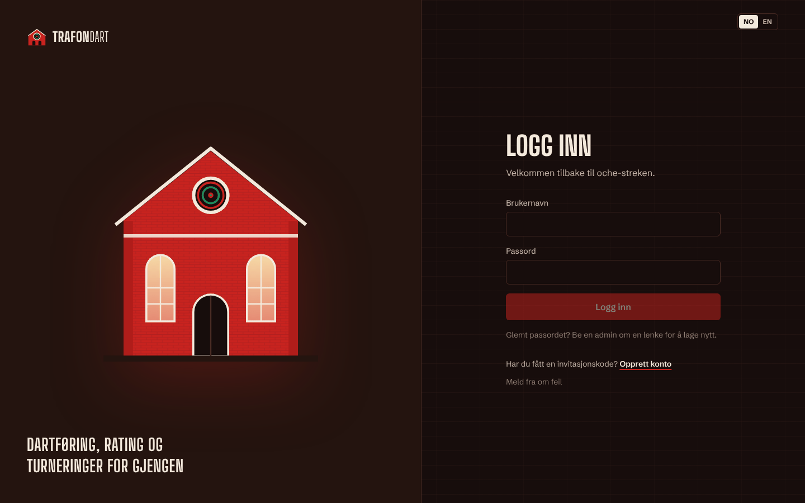

## 2. Forsiden

Forsiden viser det som skjer akkurat nå:

- **Utfordringer:** utfordringer til deg (Godta / Avslå), dine egne, og godtatte kamper som er **klare til å spille**.
- **Direkte nå:** kamper som spilles. Trykk på en kamp for å se på (eller føre den, hvis du spiller).
- **Selskapsspill nå:** Cricket, Killer og de andre spillene som pågår.
- I desember og januar: et kort som tar deg til **årsoppsummeringen** din.
- **Siste resultater:** de nyeste kampene, med 3-pilssnitt, kudos og kommentarer.
- **Månedens spiller:** forrige måneds vinner og topp tre i kampen om denne måneden.
- **Ratingtabell:** de beste akkurat nå. Kronen viser hvem som er regjerende månedens spiller.
- **Pågående turneringer.**

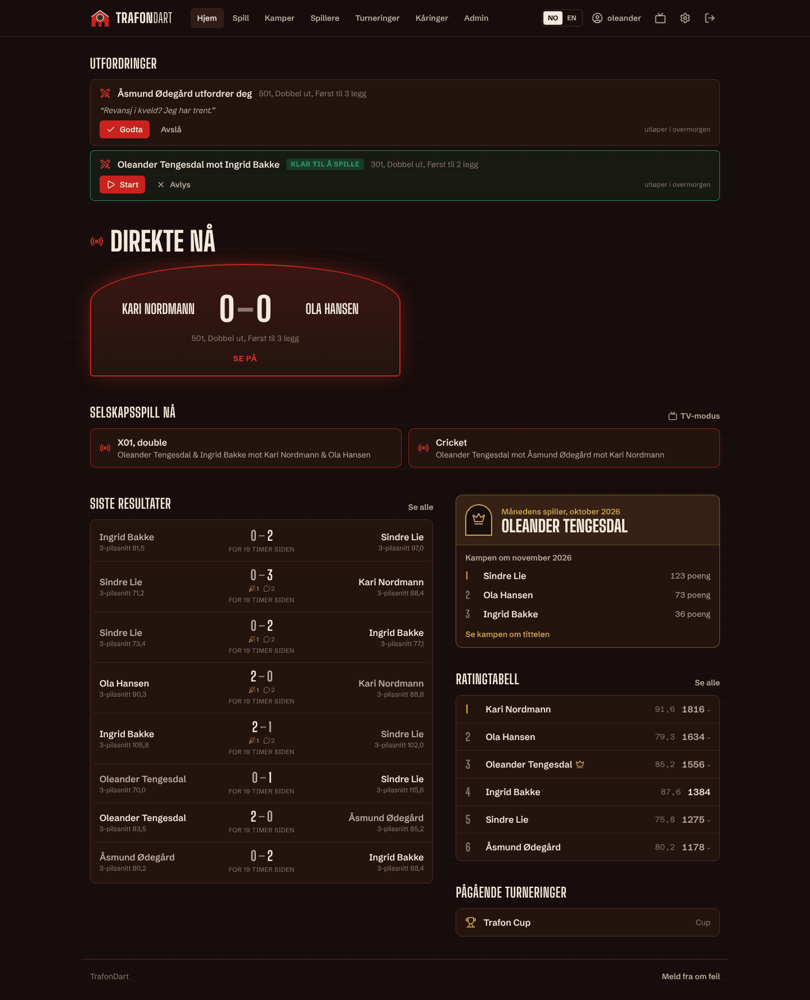

På mobilen ligger menyen nederst på skjermen.

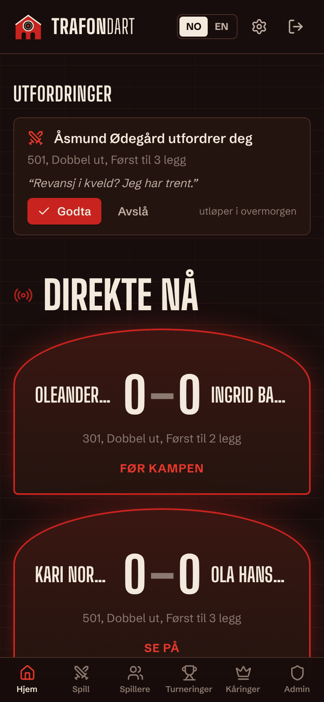

## 3. Start en kamp

Gå til **Spill**.

1. Velg **spiller 1** og **spiller 2**. Pilen mellom dem bytter plass.
2. Velg hvem som **kaster først**, eller la appen trekke tilfeldig.
3. Velg **spill** (301, 501 eller 701), **start** (rett inn eller dobbel inn), **avslutning** (rett ut, dobbel ut eller master ut) og hvor mange **legg** som trengs for å vinne.
4. **Teller på ratingen** er på som standard. Slå den av for treningskamper. Treningskamper teller ikke på ratingen eller i kåringen av månedens spiller, men vises i statistikken din.
5. Trykk **Start kampen**.

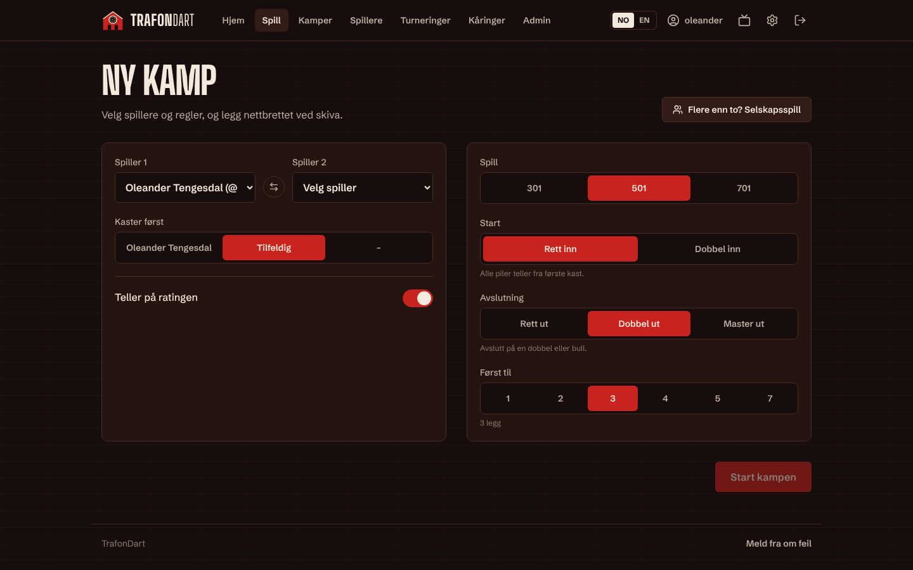

## 4. Før kampen fra nettbrettet

Legg nettbrettet ved skiva, liggende. Begge spillerne kan føre.

**Installer appen** på nettbrettet, så får den et eget ikon og fyller hele skjermen uten nettleserlinje:

- **iPad (Safari):** Del-knappen → **Legg til på Hjem-skjerm**.
- **Android (Chrome):** menyen ⋮ → **Installer app** (eller *Legg til på startskjermen*).
- **PC/Mac (Chrome/Edge):** installer-ikonet til høyre i adressefeltet.

Appen åpner seg da med en gang, også når serveren sover. Står det **«Vekker serveren»**, tar det vanligvis under ett minutt. Under en kamp holder appen **skjermen våken**, så nettbrettet ikke låser seg mellom rundene.

- Trykk **Dobbel** eller **Trippel** først, deretter tallet. Ellers teller det som enkel.
- **25** er ytre bull, **Bull** er bullseye, **Bom** er en pil utenfor.
- **Angre** fjerner den siste pila, også hvis den avsluttet et legg.
- Kortet **Denne runden** viser pilene i runden og summen. Når det finnes en utgang, foreslår appen den beste veien, for eksempel `T20 20 D20`.
- **Bust** oppdages automatisk: under null, 1 igjen med dobbel ut, eller avslutning på feil pil. Runden telles da som 0, og poengsummen settes tilbake.
- 180, utganger på 100+ og vinnerpiler får lys, lyd og en stemme som roper det ut. Lyd og stemme kan slås av under *Innstillinger*.

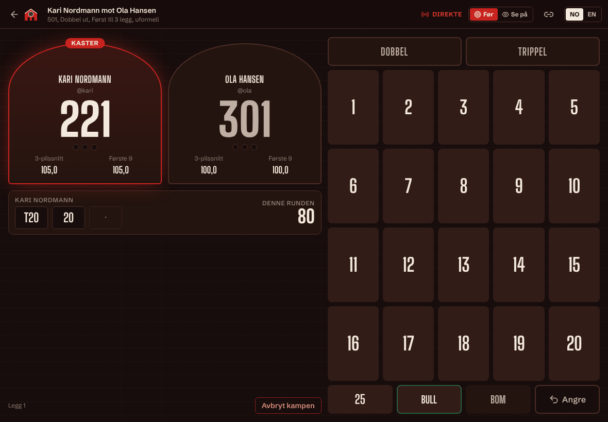

Det går fint å føre på mobil også:

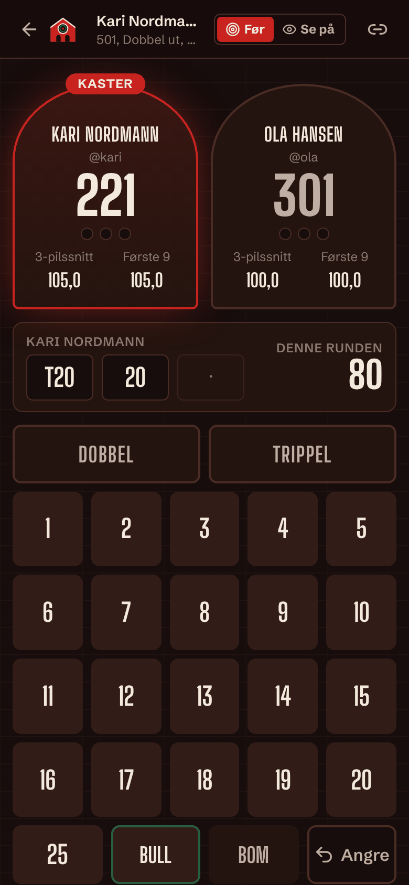

Trykker du fort, legges pilene i kø og sendes i riktig rekkefølge, selv om nettet er tregt. Prøver to enheter å føre samme kamp samtidig, vinner den som var først, og den andre oppdaterer seg selv.

**Mistet nettet?** Bare fortsett å føre. Det står **«Ingen forbindelse»** og hvor mange piler som venter. Pilene lagres på nettbrettet (også om du laster inn siden på nytt) og sendes av seg selv når nettet er tilbake. Ingen pil blir telt to ganger.

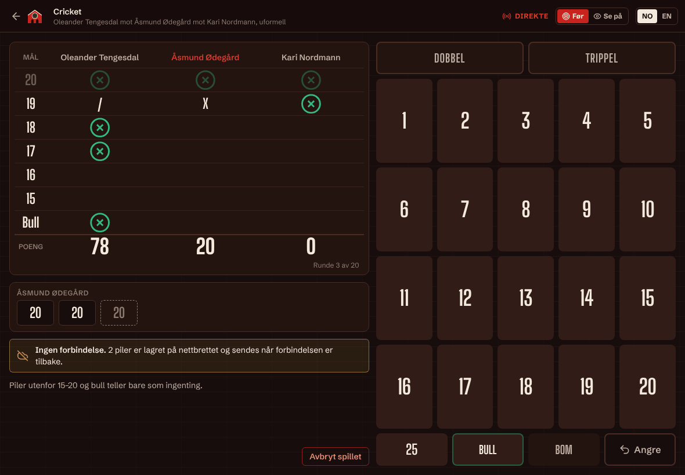

**Avbryt kampen** stopper en kamp som ikke skal spilles ferdig. Avbrutte kamper teller ikke.

## 5. Se på live fra mobilen

Alle i gjengen kan åpne kampen og følge med. Hver pil dukker opp med en gang. Spillerne kan bytte mellom **Før** og **Se på** øverst. Lenke-knappen kopierer adressen til kampen, så du kan sende den i gruppechatten.

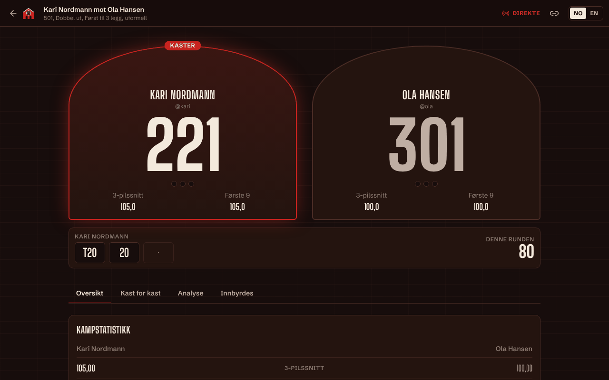

## 6. Etter kampen: analyse, kudos og kommentarer

En ferdig kamp har fire faner:

| Fane | Hva du ser |
|---|---|
| **Oversikt** | kampstatistikk side om side (snitt, første 9, 180, 140+, 100+, utgangsprosent …) og alle legg |
| **Kast for kast** | hver runde i hvert legg, med pilene, summen og hva som var igjen |
| **Analyse** | hvor rundene havnet (poengintervaller), «kappløpet mot null» per legg, et varmekart over skiva for hver spiller og vinnersjansen før kampen |
| **Innbyrdes** | alle tidligere oppgjør mellom de to |

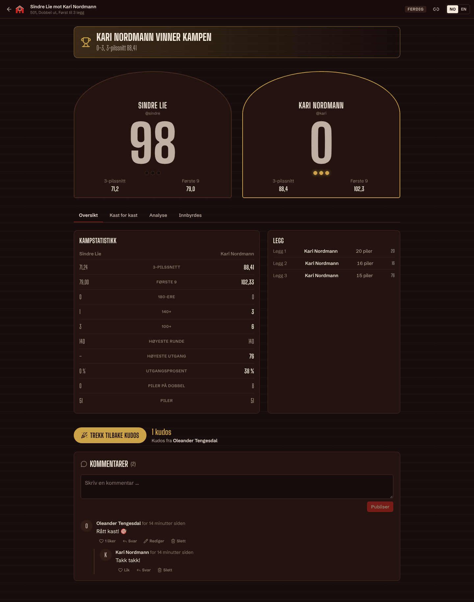

| Kast for kast | Analyse |
|---|---|
| 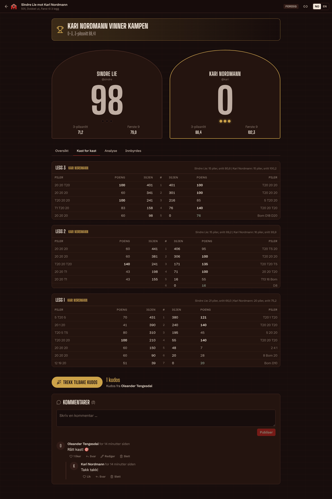 | 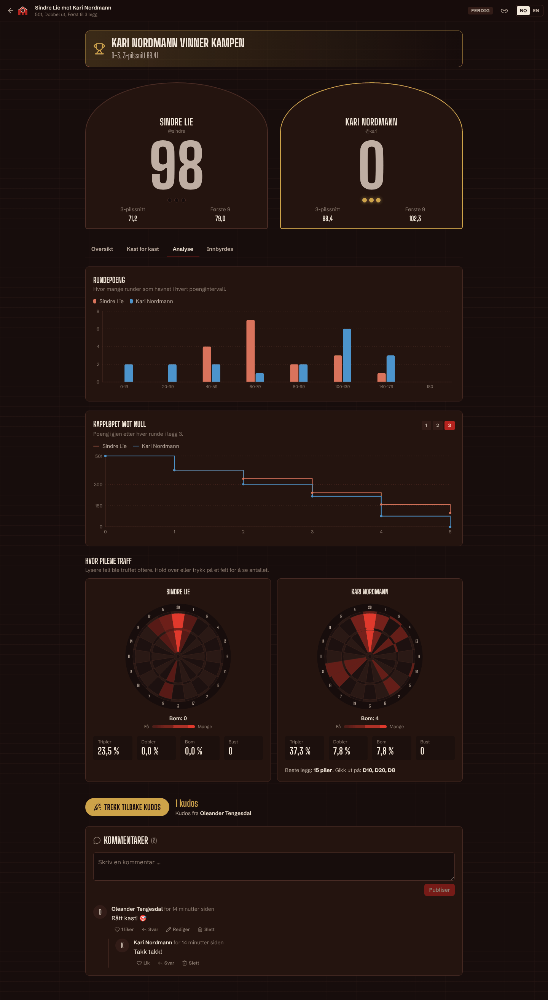 |

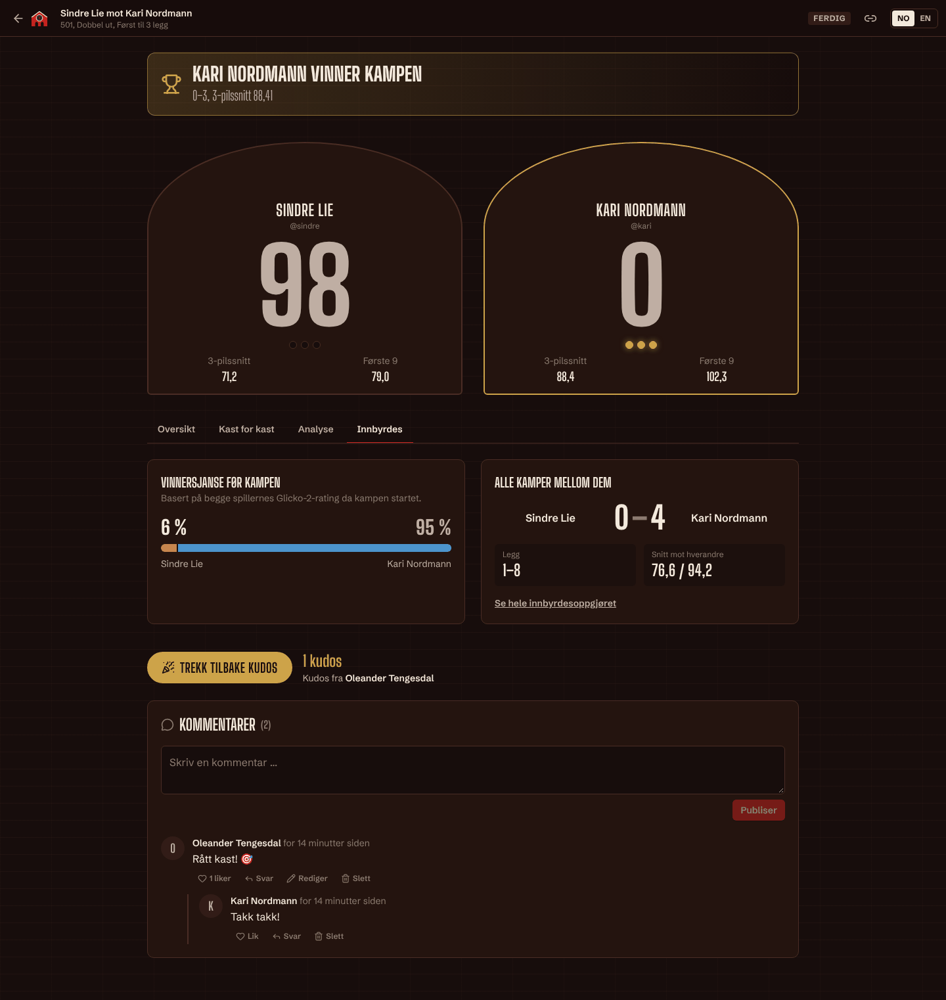

Under kampen kan du:

- gi **kudos** (ikke til dine egne kamper),
- **kommentere**, **svare** på kommentarer og **like** dem,
- redigere eller slette dine egne kommentarer.

Alt oppdateres live for alle som har siden åpen.

**Ble noe ført feil?** Spillerne kan melde fra om feilføring på en ferdig kamp. En admin ser på det og kan annullere kampen. Da regnes alle ratinger og månedens kåringer ut på nytt.

## 7. Profilen din

Trykk på navnet ditt øverst, eller på en spiller i en liste.

- **Rating** i buevinduet, med usikkerhet (±) og plass på tabellen. «Foreløpig» betyr at appen ikke kjenner nivået ditt godt nok ennå.
- **Form:** de siste kampene (S = seier, T = tap) og hvor mange på rad.
- **Tall:** kamper, legg, 3-pilssnitt, snitt første 9, utgangsprosent, høyeste utgang, 180-ere, 140+, 100+ og høyeste runde.
- **Grafer:** rating over tid og snittet i de siste kampene.
- **Dartnerdens hjørne:** varmekart over alle pilene du har kastet, trippel-, dobbel- og bullprosent, bomprosent, beste legg, piler per vunne legg, hold- og breakprosent, vanligste runde, favorittall, rundepoeng, beste utganger og favorittutganger.
- **Ditt 2026:** årsoppsummeringen din (se [kapittel 14](#14-årets-spiller-og-årsoppsummeringen)).
- **Utfordre:** på andres profil (se [kapittel 12](#12-utfordre-en-venn)).
- **Troféskap:** alle månedskåringene og årets spiller-kåringene du har vunnet.
- **Prestasjoner:** milepælene dine (se [kapittel 15](#15-prestasjoner)).
- **Selskapsspill:** spilt og vunnet per spilltype, og de siste spillene.
- **Innbyrdes** mot hver motstander, og **siste kamper**.

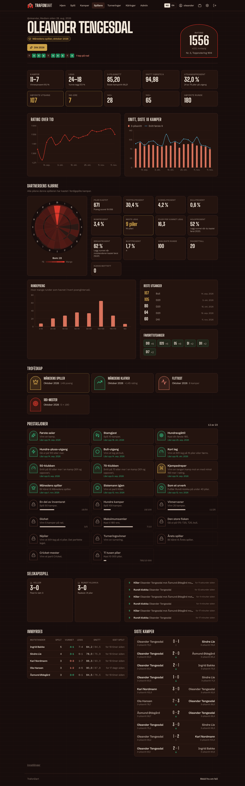

## 8. Ratingtabellen

**Spillere** viser alle, sortert etter rating, med kamper, vinnerprosent, snitt, 180-ere og høyeste utgang. Ratingen er Glicko-2: du går mest opp når du slår noen som er bedre enn deg. Mer om det i [RATINGS.md](RATINGS.md).

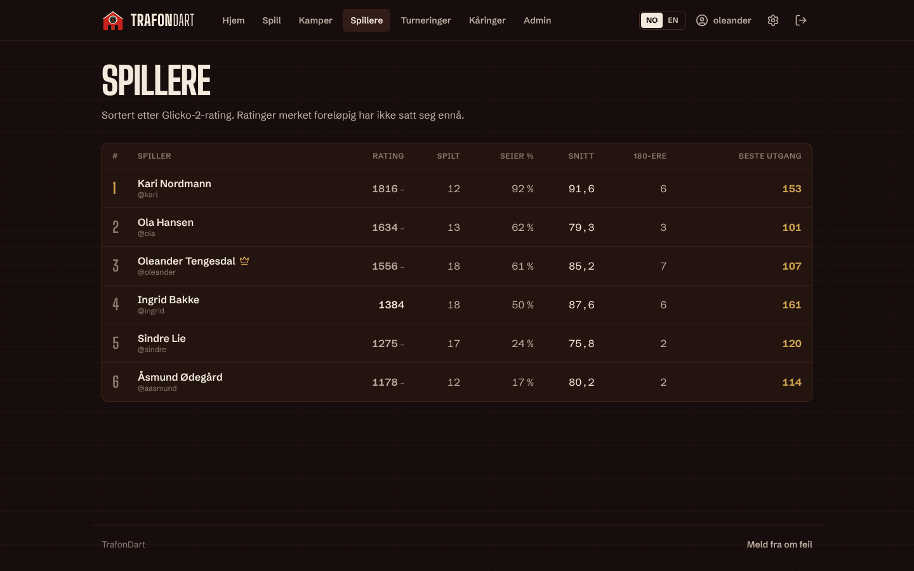

## 9. Månedens spiller

**Kåringer** i menyen. Her vinner ikke nødvendigvis den beste, men den som har hatt **den beste måneden**: gått mest frem, spilt mye, vunnet kamper og levert de store øyeblikkene.

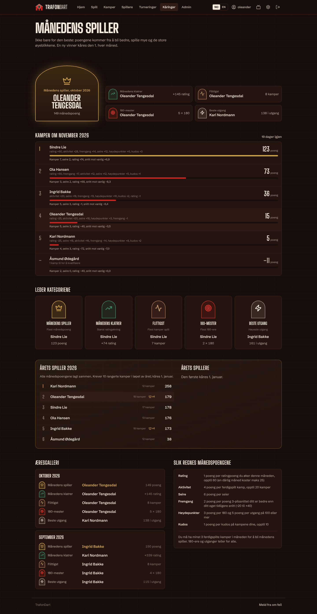

**Slik får du poeng i løpet av måneden**

| Del | Poeng |
|---|---|
| Rating | 1 per ratingpoeng du øker, opptil 60. En dårlig måned koster maks 25 |
| Aktivitet | 4 per ferdigspilt kamp, opptil 20 kamper |
| Seire | 6 per seier |
| Fremgang | 2 per poeng 3-pilssnittet ditt er bedre enn ditt eget tidligere snitt (fra −20 til +40) |
| Høydepunkter | 3 per 180 og 5 per utgang på 100 eller mer |
| Kudos | 1 per kudos på kampene dine, opptil 10 |

Bare kamper som **teller på ratingen** er med, så treningskamper teller ikke. Du må ha minst **3 ferdigspilte kamper** i måneden for å bli månedens spiller.

**De fem kåringene**

| | |
|---|---|
| 👑 **Månedens spiller** | flest månedspoeng |
| 📈 **Månedens klatrer** | størst ratingøkning |
| 〰 **Flittigst** | flest kamper |
| 🎯 **180-mester** | flest 180-ere (alle kan vinne) |
| ⚡ **Beste utgang** | høyeste utgang (alle kan vinne) |

Vinnerne kåres automatisk den 1. hver måned. De får en utmerkelse i troféskapet på profilen, og månedens spiller får en krone ved navnet sitt hele neste måned.

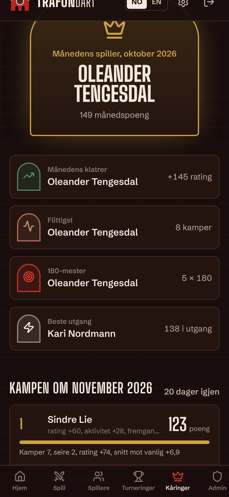

Alle detaljer står i [AWARDS.md](AWARDS.md).

## 10. Turneringer

**Turneringer → Ny turnering.** Velg format og deltakere:

- **Serie:** alle møter alle én gang. Tabellen sorteres på poeng, så leggdifferanse, legg vunnet og innbyrdes oppgjør.
- **Cup:** utslagsturnering. Seedingen følger ratingen, og de høyest rangerte får walkover i første runde hvis antallet ikke går opp.

Når turneringen er startet, trykker du **Spill** ved en kamp som er klar. I en turnering som teller på ratingen er det spillerne selv (eller en admin) som starter kampen sin. Treet fyller seg ut av seg selv når kamper blir ferdige.

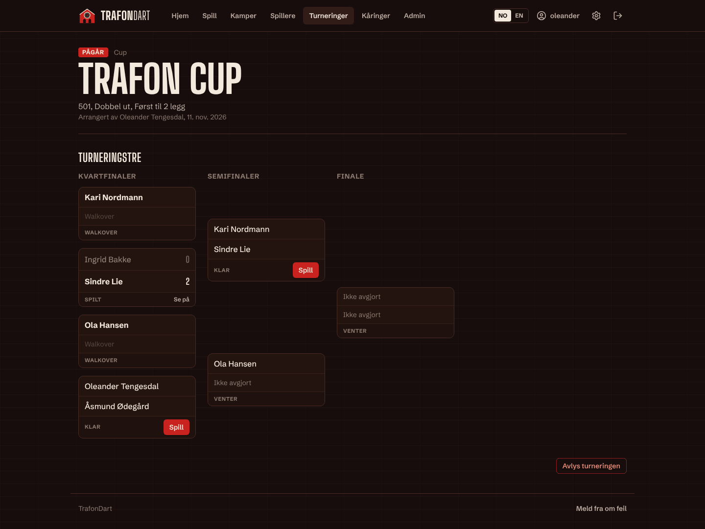

## 11. Selskapsspill: flere enn to

Er dere flere enn to? **Spill → Flere enn to? Selskapsspill** (eller knappen på forsiden).

1. Velg spill: **X01**, **Cricket**, **Killer** eller **Rundt klokka**.
2. Trykk på spillerne **i kasterekkefølge**. For **to mot to** (X01 og Cricket) slår du på bryteren og velger fire: de to første er lag A.
3. Velg innstillinger (startpoeng og avslutning for X01, rundegrense for Cricket, antall liv for Killer, om dobler og tripler hopper fram i Rundt klokka) og trykk **Start spillet**.

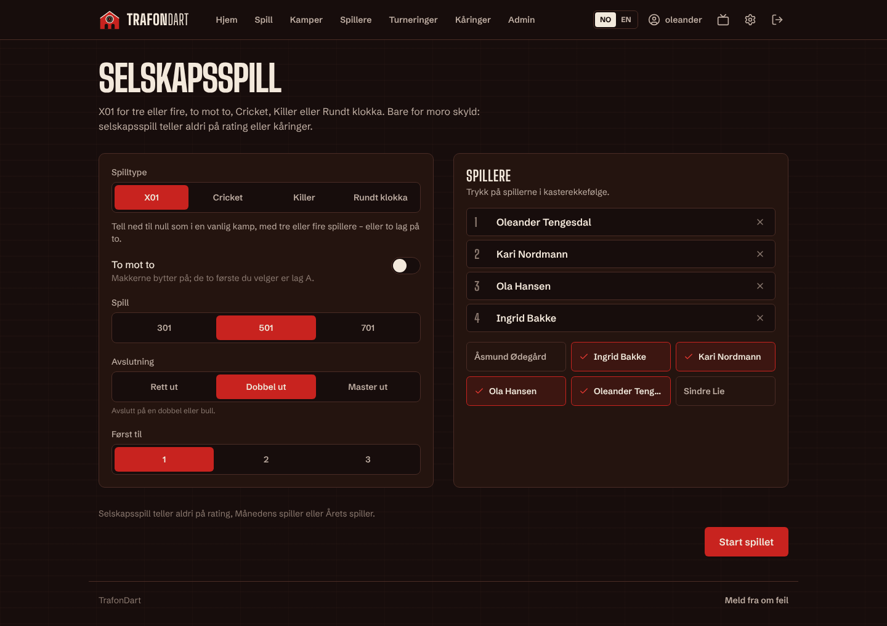

Føringen er som i en vanlig kamp, med samme tastatur, kø og offline-lagring. Tavla tilpasser seg spillet:

- **X01:** restpoeng per spiller eller lag, og utgangsforslag.
- **Cricket:** 20 til 15 og bull. `/` er ett treff, `X` to, `⊗` lukket. Poengene står nederst.
- **Killer:** tallet ditt, livene dine (hjerter) og om du er **killer**. Treff din egen dobbel først, så tar dobler på de andres tall liv.
- **Rundt klokka:** neste tall du må treffe, og hvor langt du har kommet.

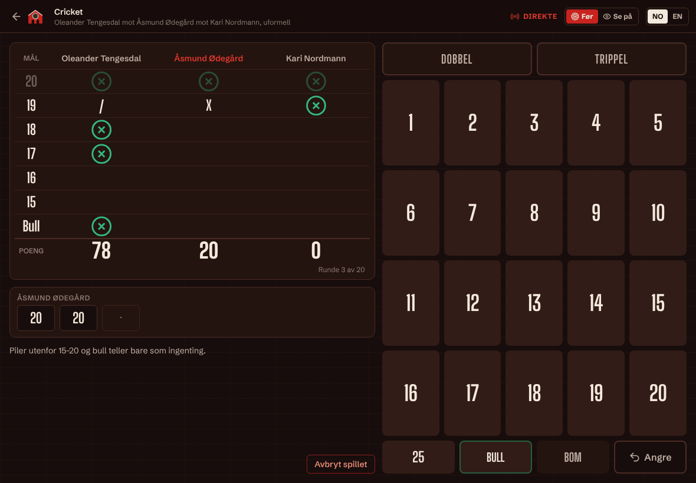

Selskapsspill er **bare for moro skyld**: de teller ikke på rating, månedens spiller eller årets spiller. De har egen statistikk på profilen, egne prestasjoner og en plass i årsoppsummeringen. Reglene står i [GAME-RULES.md](GAME-RULES.md#party-games-selskapsspill).

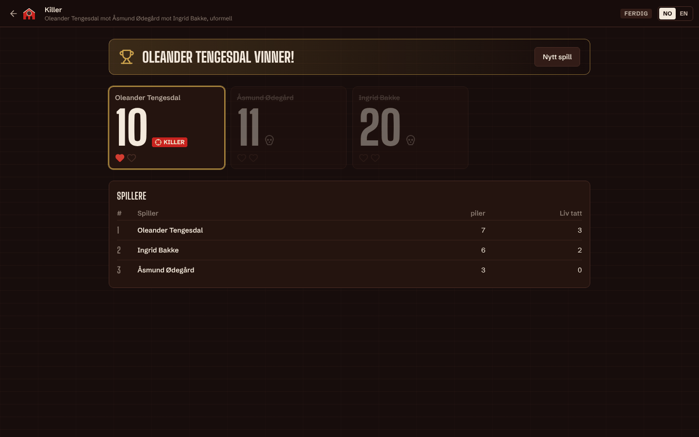

## 12. Utfordre en venn

Gå til profilen til den du vil utfordre og trykk **Utfordre**. Velg spill (301/501/701), avslutning, antall legg, om kampen skal telle på ratingen, og skriv gjerne en melding.

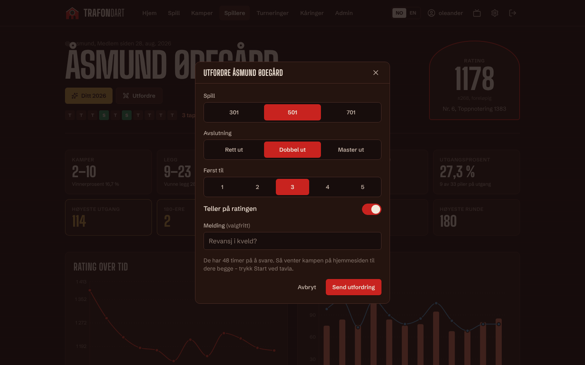

- Den andre ser utfordringen på forsiden og kan **Godta** eller **Avslå** innen 48 timer.
- En godtatt utfordring står på forsiden til dere begge som **Klar til å spille**. Trykk **Start** når dere står ved skiva, så opprettes kampen og føringen åpner seg.
- Du kan **avlyse** din egen utfordring, og begge kan avlyse en godtatt en. Du kan ha fem åpne utfordringer om gangen, og bare én med hver person.

## 13. TV-modus

Har dere en storskjerm der dere spiller? Åpne **TV-modus** (TV-ikonet øverst, eller `/tv`) på en PC eller smart-TV koblet til skjermen og trykk på fullskjermknappen.

- Pågår en kamp eller et selskapsspill, vises tavla stort, med hver pil live. Pågår flere, bytter den hvert 20. sekund.
- Ellers vises ratingtabellen, kampen om månedens spiller og de siste resultatene.
- TV-modus kan ikke endre noe, og holder skjermen våken.

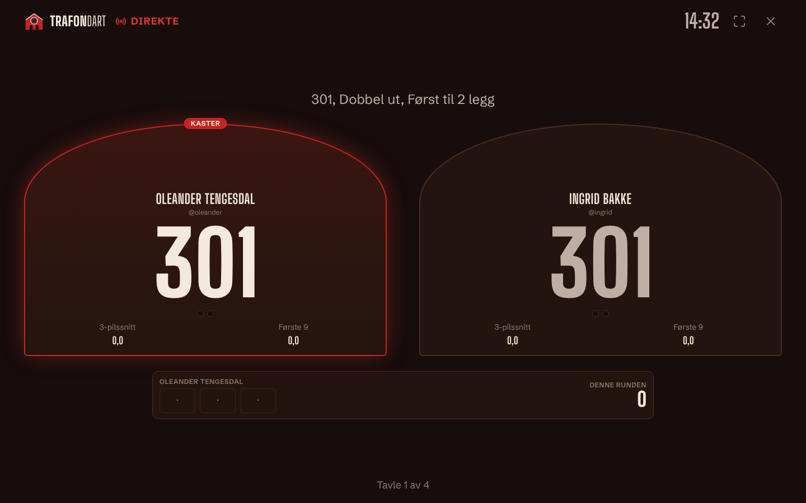

## 14. Årets spiller og årsoppsummeringen

**Årets spiller** kåres 1. januar: månedspoengene for hele året legges sammen. Du må ha minst **10 kamper som teller på ratingen** i løpet av året. Kampen om tittelen og tidligere vinnere står på **Kåringer**, og vinneren får en stjerne i troféskapet.

**Årsoppsummeringen** («Ditt 2026», på profilen og på forsiden i desember og januar) viser året ditt som en rekke kort: piler kastet (og hvor langt du har gått til skiva og tilbake), seire og tap, beste måned, favorittutgangen, erkefienden og yndlingsmotstanderen, største seier, beste kampsnitt, 180-ere, dartkvelden, selskapsspill, plassen i kampen om årets spiller og prestasjonene du låste opp. Du kan se tidligere år også, og andres oppsummeringer.

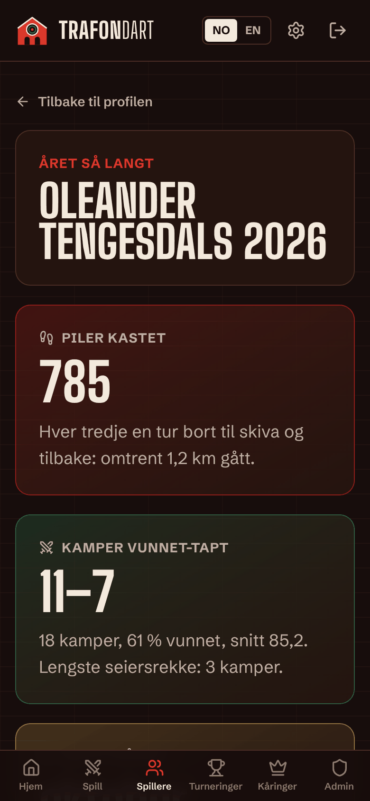

## 15. Prestasjoner

Under troféskapet på profilen ligger **prestasjonene**: milepæler du har for alltid, som første 180, en utgang på 100+, en nipiler, bull-utgang, 100 kamper og ti tusen piler. Låste prestasjoner viser hvordan du får dem, og de med telling viser hvor langt du har kommet. Trykk på en opplåst prestasjon for å se kampen der det skjedde. Hele lista står i [ACHIEVEMENTS.md](ACHIEVEMENTS.md).

Bare kamper som teller på ratingen, eller som en av spillerne selv satte opp, gir prestasjoner. Blir en kamp annullert, forsvinner det den ga.

## 16. Innstillinger og dine data

Tannhjulet øverst til høyre.

- **Språk:** norsk eller engelsk, lagret på kontoen.
- **Lydeffekter** og **stemme som roper ut poeng** (som på TV).
- **Fullt navn.**
- **Bytt passord.** Alle andre innlogginger blir logget ut.
- **Dine data:** **Last ned dataene mine** gir deg en fil med alt TrafonDart har om deg. **Slett kontoen** sletter kontoen for godt: du må skrive passordet og ordet SLETT. Kampene blir værende for motstanderne dine, men vises som spilt av «Slettet spiller». Kommentarene dine fjernes, og du kan ikke logge inn igjen. Mer i [PRIVACY.md](PRIVACY.md).
- **Logg ut overalt**, hvis du har glemt å logge ut på en annen enhet.

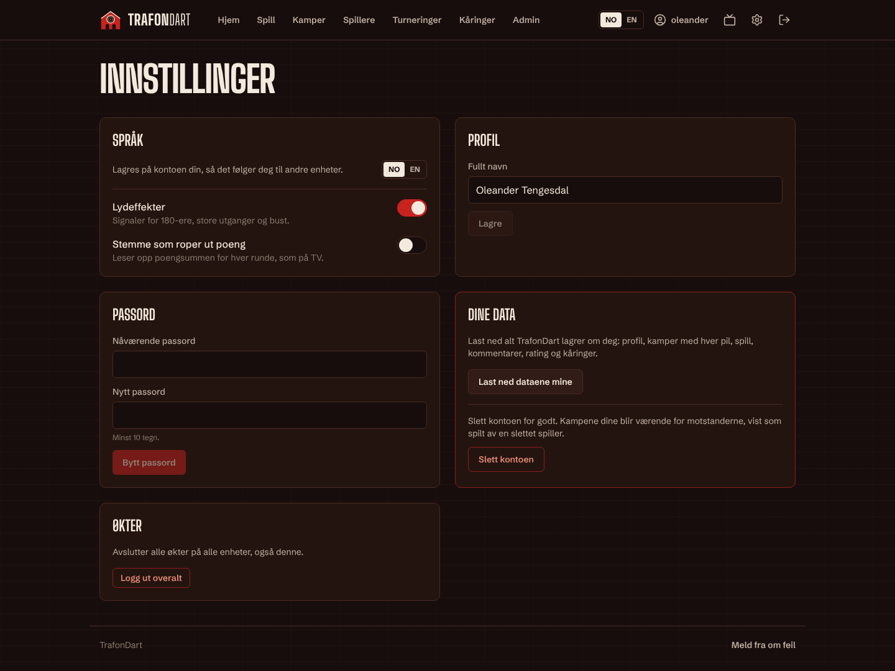

## 17. Glemt passord

Det sendes ingen e-post. Si fra til en admin, som lager en **passordlenke** til deg og sender den, for eksempel på Messenger.

- Lenken virker **én gang** i **24 timer**.
- Du velger selv nytt passord og blir logget inn. Admin ser aldri passordet.
- Alle andre steder du er logget inn blir logget ut, og en eventuell utestengelse etter feil passord oppheves.

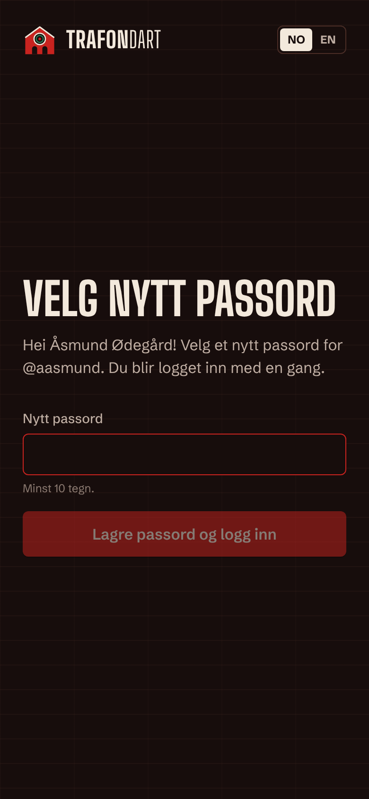

## 18. Fant du en feil?

Krasjer en side, får du opp **«Noe gikk i stykker»**. Feilen blir rapportert automatisk (uten navnet ditt), så adminene får vite om den. Last inn siden på nytt.

Vil du fortelle mer, trykk **Meld fra om feil** nederst på siden. Siden lager en ferdig e-post til adminene (adminsjef@uka.no) med siden du kom fra og hvilken nettleser du bruker. Skriv hva du gjorde, hva du forventet og hva som skjedde.

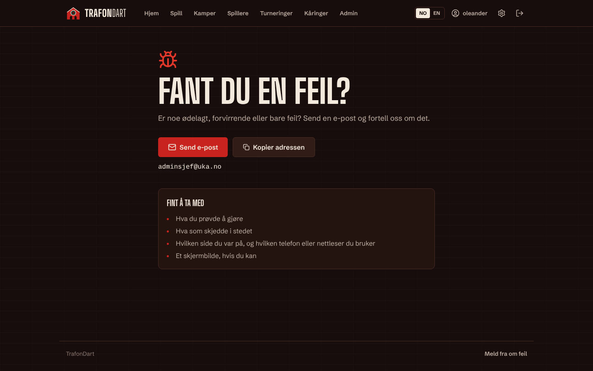

## 19. Ord og uttrykk

| Ord | Betyr |
|---|---|
| **Legg** | ett spill fra 501 (eller 301/701) ned til null. Først til et visst antall legg vinner kampen |
| **3-pilssnitt** | gjennomsnittlig poeng per runde med tre piler |
| **Snitt første 9** | snittet på de ni første pilene i hvert legg, før man begynner å sikte på utgang |
| **Utgang** | pila (eller rundene) som tar deg ned til akkurat null |
| **Utgangsprosent** | hvor mange av pilene på dobbel som traff |
| **Bust** | runden teller ikke fordi du gikk under null, fikk 1 igjen med dobbel ut, eller avsluttet feil |
| **Dobbel ut / master ut** | siste pil må være dobbel / dobbel, trippel eller bull |
| **Hold / break** | å vinne et legg der du / motstanderen kastet først |
| **Foreløpig rating** | appen har for få kamper til å være sikker på nivået ditt |
| **Walkover** | du går rett videre i cupen uten å spille |
| **Selskapsspill** | X01 for flere, to mot to, Cricket, Killer og Rundt klokka. Teller ikke på ratingen |
| **Lukke (Cricket)** | tre treff på et tall. Etter det gir tallet poeng så lenge noen ikke har lukket det |
| **Killer** | i spillet Killer: den som har truffet sin egen dobbel og kan ta liv fra de andre |
